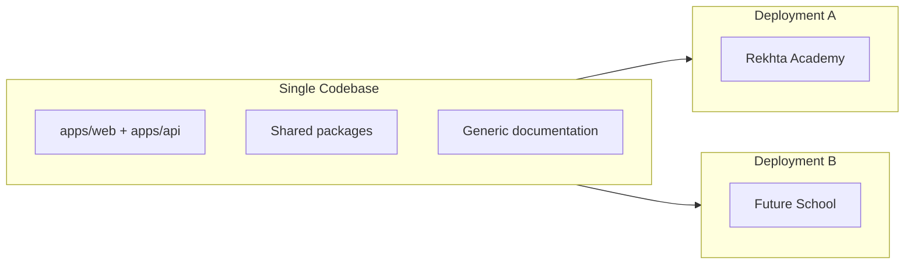

# Product Vision

## Overview

The Educational Institution Management System (EIMS) is a white-label ERP designed for Pakistani educational institutions: **schools**, **colleges**, and **evening coaching centers**. It manages students, parents, teachers, staff, attendance, assessments, fees, timetables, reporting, and analytics.

The product is built once and deployed many times. Each institution receives a **complete, independent deployment** with its own database, domain, and branding. There is no shared multi-tenant database.

## Product Model

| Aspect | Approach |
|--------|----------|
| Codebase | One monorepo, version-controlled |
| Per customer | Full copy or deploy from release tag |
| Database | Separate Supabase project per institution |
| Branding | Config only (name, logo, address, contact) |
| Code changes | Never fork per customer |

## First Deployment: Rekhta Academy

Rekhta Academy Pakistan is the **reference deployment** and drives initial feature development. The original client requirements live in [ERP-Requirements.docx](ERP-Requirements.docx).

Rekhta ships with the `coaching` institution profile, emphasizing:

- Dynamic programs (SSC, HSSC, MDCAT, ECAT, etc.)
- Batches (Morning, Evening, Weekend)
- Assessment series (FLP, Grand Test, Mock Test)
- Multi-branch coaching center operations

Rekhta-specific values (name, logo, address) live in configuration files — never in application source code.

## Institution Types

Three profiles share the same codebase with different defaults:

| Profile | Typical use | Default terminology | Module emphasis |
|---------|-------------|---------------------|-----------------|
| `coaching` | Evening coaching centers, test prep | Batch, Program | Assessments, rankings, FLP series |
| `school` | Primary/secondary schools | Class, Grade, Section | Timetable, parent engagement |
| `college` | Intermediate, degree colleges | Section, Semester | Academic sessions, subject groups |

Terminology and enabled modules are overridable per deployment via `InstitutionSettings` and feature flags. See [14-white-label-config.md](14-white-label-config.md).

## Target Users (Roles)

All roles are **dynamic** — stored in the database, not hardcoded. Default roles seeded on first deploy:

| Role | Scope | Key responsibilities |
|------|-------|----------------------|
| Super Admin | Institution-wide | Branches, global academic structure, permissions, cross-branch reports |
| Branch Admin | Single branch | Admissions, staff, attendance, fees, branch reporting |
| Teacher | Assigned batches | Marks entry, view attendance, academic reports |
| Accountant | Branch | Fee collection, financial reports |
| Receptionist | Branch | Student records, parent communication |
| Parent | Linked children | Attendance, reports, fees, notices |
| Student | Self | Attendance, reports, timetable, performance |

Permissions are granular and configurable per role. See [08-auth-and-rbac.md](08-auth-and-rbac.md).

## Pakistan-Specific Context

The system is designed for local compliance and conventions:

| Domain | Convention |
|--------|------------|
| Identity | CNIC (adults), B-Form (minors) — validated format |
| Phone | `+92` prefix, mobile format validation |
| Currency | PKR (Pakistani Rupee) |
| Timezone | `Asia/Karachi` default |
| Academic boards | Configurable (FBISE, BISE Lahore, Cambridge, etc.) — not hardcoded |
| Address | City, province fields (Punjab, Sindh, KPK, Balochistan, ICT) |
| Language | English UI default; i18n structure for Urdu RTL (future) |

## System Objectives

From the requirements document, mapped to product goals:

1. **Multi-branch management** — unlimited branches per institution, strict data isolation
2. **Centralized administration** — Super Admin with cross-branch visibility
3. **Dynamic academic structure** — programs, batches, subjects, sessions configured by admins
4. **Dynamic assessment structure** — types, series, and records without code changes
5. **Attendance management** — students, teachers, staff (Phase 2: AI OCR)
6. **Student performance tracking** — subject-wise, test-wise, rankings, weak-subject alerts
7. **Parent engagement** — portal access, notices, fee visibility
8. **Fee management** — configurable fee types, discounts, scholarships, defaulter reports
9. **Reporting & analytics** — dashboards, exportable reports
10. **Security-first** — RBAC, audit logs, MFA for admins
11. **Extensibility** — mobile-ready API, future AI integrations

## Design Principles

These apply to every deployment, every institution type:

1. **No hardcoded academic structures** — programs, subjects, assessments are data
2. **No hardcoded roles** — RBAC matrix in database
3. **Branch isolation** — `branchId` on all operational entities
4. **Configuration over code** — rebranding never requires source edits
5. **Auditability** — critical actions logged immutably
6. **API-first** — same backend serves web now, mobile apps later
7. **Security by default** — RLS, JWT, encryption, MFA

## What Changes Per Customer

Only these surfaces differ between deployments:

- Institution name, logo, favicon
- Address, city, province, country
- Phone, email, website
- Institution type profile (`coaching` | `school` | `college`)
- Theme colors (optional)
- Domain and deployment URLs
- Seed data (programs, branches specific to that institution)

## What Never Changes Per Customer

- Folder structure and package layout
- API route definitions
- Prisma models and migrations
- RBAC logic and guard implementations
- UI components and page structure
- NestJS module boundaries

## Roadmap Phases

| Phase | Scope |
|-------|-------|
| **Phase 1 (MVP)** | Auth, branches, academic structure, students/parents, attendance, assessments, basic fees, notices, audit, white-label settings |
| **Phase 2** | Timetable + conflict detection, form builder, advanced analytics, document management |
| **Phase 3** | AI attendance OCR, SMS/WhatsApp, mobile apps, AI performance insights |

See [13-feature-modules.md](13-feature-modules.md) for the full module breakdown.

## Related Documents

- [02-system-architecture.md](02-system-architecture.md) — technical architecture
- [14-white-label-config.md](14-white-label-config.md) — branding configuration
- [17-clone-and-rebrand.md](17-clone-and-rebrand.md) — deploying for a new institution
