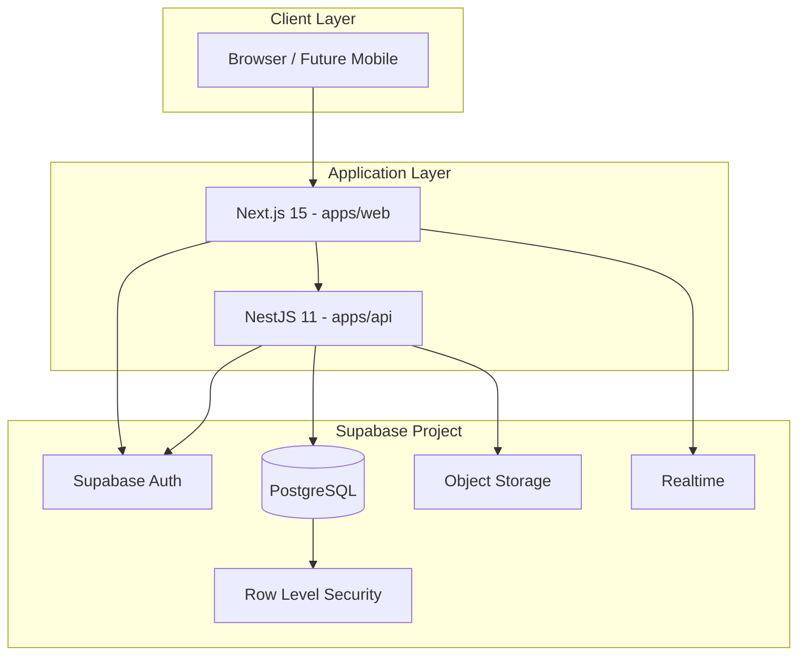
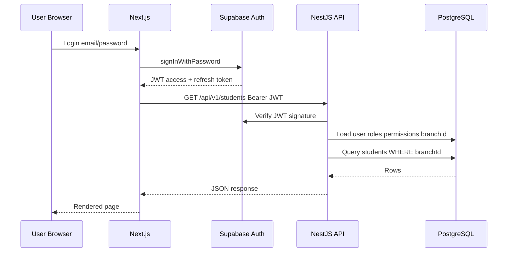
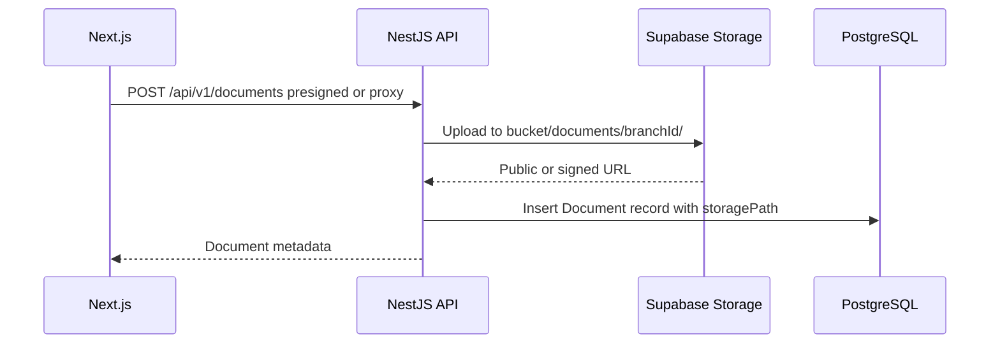
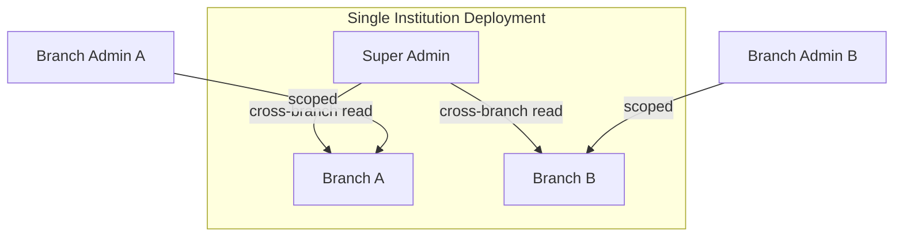
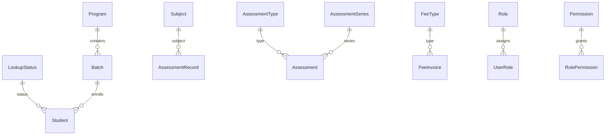
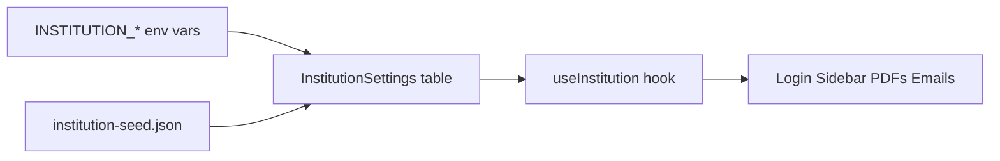
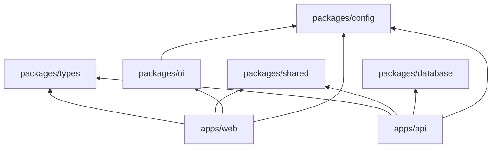
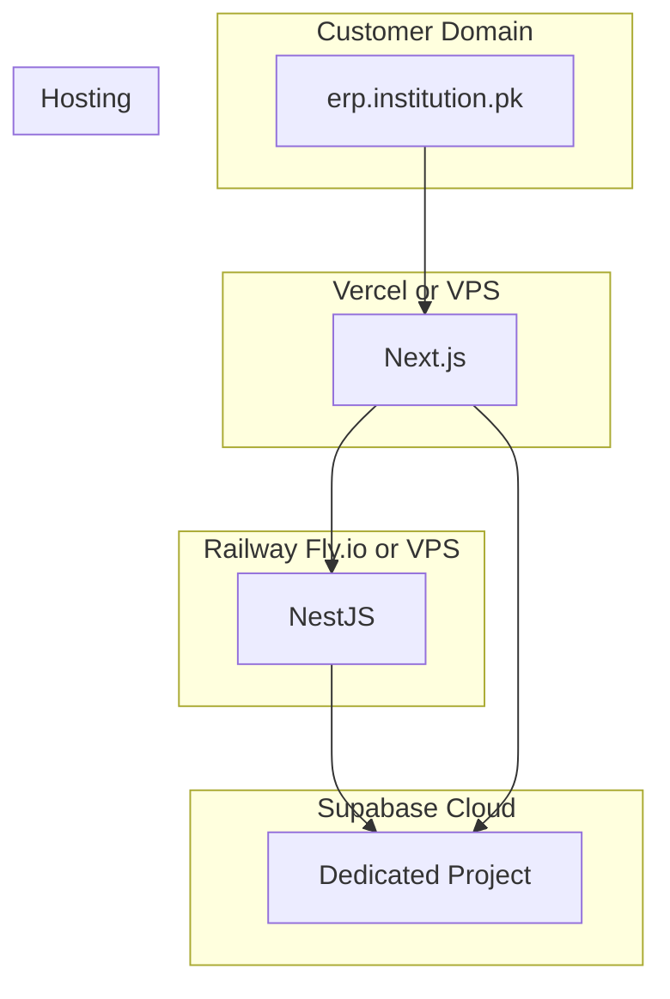

# System Architecture

## High-Level Overview

Each institution runs an isolated stack: a Next.js web app, a NestJS API, and a dedicated Supabase project (PostgreSQL, Auth, Storage, Realtime, RLS).



## Request Flow

### Authenticated API Request



### File Upload Flow



## Responsibility Split: NestJS vs Supabase

| Concern | Owner | Rationale |
|---------|-------|-----------|
| User login, signup, password reset | Supabase Auth | Battle-tested auth, MFA, email templates |
| JWT issuance & refresh | Supabase Auth | Standard OAuth2/JWT flow |
| File storage (photos, documents) | Supabase Storage | S3-compatible, signed URLs, bucket policies |
| Live updates (notices, attendance) | Supabase Realtime | WebSocket subscriptions from Next.js |
| Row-level branch isolation (defense in depth) | Supabase RLS | Extra layer if client reads DB directly |
| Business logic (fees, marks, rankings) | NestJS | Complex rules, transactions, validations |
| Reports & aggregations | NestJS | Heavy queries, export generation |
| Audit logging | NestJS | Immutable append-only log service |
| Prisma ORM & migrations | NestJS via `packages/database` | Type-safe queries, migration history |
| Invitation workflow | NestJS | Custom email + token logic |
| Timetable conflict detection | NestJS | Multi-entity validation |

**Rule:** The Next.js app never writes business data directly to PostgreSQL. All mutations go through the NestJS API. Supabase client is used for Auth, Storage uploads (where appropriate), and Realtime subscriptions.

## Branch Isolation Architecture

There is no `tenantId` — each deployment serves one institution. Isolation happens at the **branch** level within that institution.



### Enforcement Layers

1. **Database** — `branchId` column on all operational tables, indexed
2. **Prisma middleware** — auto-inject `branchId` filter for branch-scoped queries
3. **NestJS guard** — `@BranchScope()` decorator reads `branchId` from JWT claims
4. **API validation** — reject requests where resource `branchId` ≠ user's branch (unless Super Admin)
5. **Supabase RLS** — policies on tables that may be read directly: `branch_id = (auth.jwt() ->> 'branch_id')`

## Dynamic Configuration Architecture

Academic and operational structures are **never enums in code**. They are database entities:



Admins create, edit, and deactivate these via the UI. The application reads labels and codes from the database at runtime.

## White-Label Configuration Layer

Institution branding is a thin configuration layer consumed by all apps:



See [14-white-label-config.md](14-white-label-config.md) for the full config schema.

## Monorepo Package Dependencies



- `packages/types` — pure TypeScript interfaces, no runtime deps
- `packages/shared` — Zod schemas, constants, utilities (depends on `types`)
- `packages/database` — Prisma client (depends on nothing in monorepo)
- `packages/ui` — shared shadcn components (depends on `config`)

## Module Architecture (NestJS)

Each domain is a self-contained NestJS module:

```
apps/api/src/
├── auth/
├── branches/
├── academic/        # programs, batches, subjects, sessions
├── students/
├── parents/
├── users/           # invitations, onboarding
├── attendance/
├── assessments/
├── fees/
├── timetable/
├── analytics/
├── notices/
├── documents/
├── form-builder/
├── audit/
└── settings/        # institution config, feature flags
```

Each module contains: `*.module.ts`, `*.controller.ts`, `*.service.ts`, `dto/`, and optionally `*.guard.ts`.

## Frontend Architecture (Next.js)

```
apps/web/src/
├── app/
│   ├── (auth)/          # login, forgot-password, invite
│   ├── (dashboard)/     # role-based layouts
│   │   ├── admin/
│   │   ├── teacher/
│   │   ├── parent/
│   │   └── student/
│   └── api/             # optional Next.js route handlers (BFF)
├── components/
│   ├── ui/              # shadcn primitives
│   └── features/        # domain components
├── hooks/
├── lib/
│   ├── api-client.ts
│   └── supabase.ts
└── providers/
```

Route groups enforce layout and auth boundaries. Role-based menu items are driven by permissions from the API, not hardcoded role checks in the router.

## Realtime Architecture

Supabase Realtime is used for **read-only live updates** where low-latency matters:

| Channel | Event | Subscriber |
|---------|-------|------------|
| `notices:branch:{id}` | new notice | Dashboard users in branch |
| `attendance:batch:{id}` | attendance marked | Teacher dashboard |

Mutations still go through NestJS. After a successful API write, NestJS can broadcast via Supabase Realtime or the client invalidates TanStack Query cache.

## Future Extension Points

Architecture is designed for these without structural changes:

| Extension | Hook |
|-----------|------|
| Mobile apps (React Native) | Same NestJS API, same JWT auth |
| AI attendance OCR | New `attendance/ocr` module, Storage trigger |
| SMS / WhatsApp | `notices` module notification provider interface |
| Payment gateways (JazzCash, EasyPaisa) | `fees/payment-providers` strategy pattern |
| Urdu localization | `next-intl` message files, RTL layout toggle |
| License server | Optional telemetry package, not in customer deployments |

## Deployment Topology



One Supabase project per institution. API and web can share a VPS or use separate PaaS services.

## Related Documents

- [03-tech-stack.md](03-tech-stack.md) — library choices
- [04-monorepo-structure.md](04-monorepo-structure.md) — folder layout
- [07-database-design.md](07-database-design.md) — entity design
- [08-auth-and-rbac.md](08-auth-and-rbac.md) — authentication flow
- [15-deployment.md](15-deployment.md) — provisioning steps
