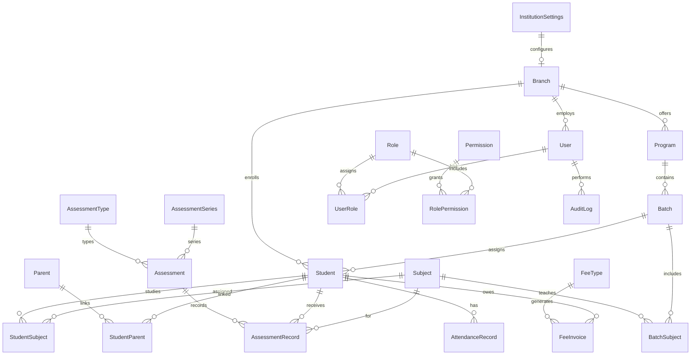

# Database Design

## Principles

1. **Branch-scoped** — operational data carries `branchId`; Super Admin bypasses in application layer
2. **Soft deletes** — `deletedAt` on user-facing entities; never hard-delete students or financial records
3. **Audit fields** — `createdAt`, `updatedAt`, `createdById` on mutable entities
4. **Dynamic lookups** — business statuses, types, and labels in lookup tables, not Prisma enums
5. **Single institution** — no `tenantId`; one deployment = one institution
6. **JSON for flexibility** — form-builder field defs, feature flags, terminology maps

## Entity Relationship Overview



## Core Models

### Institution & Branch

```prisma
model InstitutionSettings {
  id               String   @id @default("default")
  name             String
  logoUrl          String?
  faviconUrl       String?
  primaryColor     String   @default("#2563eb")
  address          String?
  city             String?
  province         String?
  country          String   @default("Pakistan")
  phone            String?
  email            String?
  website          String?
  timezone         String   @default("Asia/Karachi")
  currency         String   @default("PKR")
  institutionType  String   @default("coaching")
  terminology      Json     @default("{}")
  featureFlags     Json     @default("{}")
  createdAt        DateTime @default(now())
  updatedAt        DateTime @updatedAt
}

model Branch {
  id        String    @id @default(cuid())
  name      String
  code      String    @unique
  address   String?
  city      String?
  phone     String?
  email     String?
  isActive  Boolean   @default(true)
  createdAt DateTime  @default(now())
  updatedAt DateTime  @updatedAt
  deletedAt DateTime?

  users    User[]
  students Student[]
  programs Program[]
}
```

### Users & RBAC

```prisma
model User {
  id             String    @id @default(cuid())
  supabaseUserId String    @unique
  email          String    @unique
  fullName       String
  phone          String?
  branchId       String?
  isActive       Boolean   @default(true)
  lastLoginAt    DateTime?
  createdAt      DateTime  @default(now())
  updatedAt      DateTime  @updatedAt
  deletedAt      DateTime?

  branch    Branch?    @relation(fields: [branchId], references: [id])
  userRoles UserRole[]

  @@index([branchId])
  @@index([supabaseUserId])
}

model Role {
  id          String   @id @default(cuid())
  code        String   @unique
  name        String
  description String?
  isSystem    Boolean  @default(false)
  createdAt   DateTime @default(now())
  updatedAt   DateTime @updatedAt

  userRoles       UserRole[]
  rolePermissions RolePermission[]
}

model Permission {
  id          String   @id @default(cuid())
  code        String   @unique
  name        String
  module      String
  createdAt   DateTime @default(now())

  rolePermissions RolePermission[]
}

model UserRole {
  id        String   @id @default(cuid())
  userId    String
  roleId    String
  branchId  String?
  createdAt DateTime @default(now())

  user User @relation(fields: [userId], references: [id])
  role Role @relation(fields: [roleId], references: [id])

  @@unique([userId, roleId, branchId])
}

model RolePermission {
  id           String @id @default(cuid())
  roleId       String
  permissionId String

  role       Role       @relation(fields: [roleId], references: [id])
  permission Permission @relation(fields: [permissionId], references: [id])

  @@unique([roleId, permissionId])
}
```

### Dynamic Lookups

```prisma
model LookupCategory {
  id    String @id @default(cuid())
  code  String @unique
  name  String

  statuses LookupStatus[]
}

model LookupStatus {
  id         String  @id @default(cuid())
  categoryId String
  code       String
  label      String
  sortOrder  Int     @default(0)
  isActive   Boolean @default(true)

  category LookupCategory @relation(fields: [categoryId], references: [id])

  @@unique([categoryId, code])
}
```

**Categories:** `student_status`, `attendance_status`, `gender`, `parent_relationship`

### Academic Structure

```prisma
model Program {
  id          String    @id @default(cuid())
  branchId    String
  name        String
  code        String?
  description String?
  isActive    Boolean   @default(true)
  createdAt   DateTime  @default(now())
  updatedAt   DateTime  @updatedAt
  deletedAt   DateTime?

  branch  Branch  @relation(fields: [branchId], references: [id])
  batches Batch[]

  @@unique([branchId, code])
  @@index([branchId])
}

model Batch {
  id           String    @id @default(cuid())
  branchId     String
  programId    String
  name         String
  code         String?
  sessionId    String?
  scheduleType String?
  isActive     Boolean   @default(true)
  createdAt    DateTime  @default(now())
  updatedAt    DateTime  @updatedAt
  deletedAt    DateTime?

  program  Program  @relation(fields: [programId], references: [id])
  students Student[]

  @@index([branchId])
  @@index([programId])
}

model Subject {
  id        String    @id @default(cuid())
  name      String
  code      String?   @unique
  isActive  Boolean   @default(true)
  createdAt DateTime  @default(now())
  updatedAt DateTime  @updatedAt
  deletedAt DateTime?
}

model AcademicSession {
  id        String   @id @default(cuid())
  name      String
  startDate DateTime
  endDate   DateTime
  isCurrent Boolean  @default(false)
  createdAt DateTime @default(now())
  updatedAt DateTime @updatedAt
}
```

### Students & Parents

```prisma
model Student {
  id            String    @id @default(cuid())
  branchId      String
  fullName      String
  dateOfBirth   DateTime?
  gender        String?
  cnicOrBForm   String?
  phone         String?
  email         String?
  address       String?
  photographUrl String?
  programId     String?
  batchId       String?
  statusId      String
  customFields  Json      @default("{}")
  createdAt     DateTime  @default(now())
  updatedAt     DateTime  @updatedAt
  deletedAt     DateTime?
  createdById   String?

  branch             Branch              @relation(fields: [branchId], references: [id])
  batch              Batch?              @relation(fields: [batchId], references: [id])
  studentParents     StudentParent[]
  assessmentRecords  AssessmentRecord[]
  attendanceRecords  AttendanceRecord[]
  feeInvoices        FeeInvoice[]

  @@index([branchId])
  @@index([batchId])
  @@index([statusId])
}

model Parent {
  id        String    @id @default(cuid())
  fullName  String
  phone     String?
  email     String?
  address   String?
  cnic      String?
  createdAt DateTime  @default(now())
  updatedAt DateTime  @updatedAt
  deletedAt DateTime?

  studentParents StudentParent[]
}

model StudentParent {
  id               String @id @default(cuid())
  studentId        String
  parentId         String
  relationshipCode String

  student Student @relation(fields: [studentId], references: [id])
  parent  Parent  @relation(fields: [parentId], references: [id])

  @@unique([studentId, parentId])
}
```

### Assessments

```prisma
model AssessmentType {
  id        String   @id @default(cuid())
  name      String
  code      String   @unique
  isActive  Boolean  @default(true)
  createdAt DateTime @default(now())
}

model AssessmentSeries {
  id        String   @id @default(cuid())
  name      String
  code      String   @unique
  isActive  Boolean  @default(true)
  createdAt DateTime @default(now())

  assessments Assessment[]
}

model Assessment {
  id           String   @id @default(cuid())
  branchId     String
  name         String
  typeId       String
  seriesId     String?
  sessionId    String?
  totalMarks   Decimal  @db.Decimal(10, 2)
  conductedAt  DateTime?
  createdAt    DateTime @default(now())
  updatedAt    DateTime @updatedAt

  series  AssessmentSeries? @relation(fields: [seriesId], references: [id])
  records AssessmentRecord[]

  @@index([branchId])
}

model AssessmentRecord {
  id             String   @id @default(cuid())
  assessmentId   String
  studentId      String
  subjectId      String
  obtainedMarks  Decimal? @db.Decimal(10, 2)
  percentage     Decimal? @db.Decimal(5, 2)
  grade          String?
  rank           Int?
  remarks        String?
  createdAt      DateTime @default(now())
  updatedAt      DateTime @updatedAt
  createdById    String?

  assessment Assessment @relation(fields: [assessmentId], references: [id])
  student    Student    @relation(fields: [studentId], references: [id])

  @@unique([assessmentId, studentId, subjectId])
  @@index([studentId])
}
```

### Attendance

```prisma
model AttendanceRecord {
  id         String   @id @default(cuid())
  branchId   String
  entityType String
  entityId   String
  date       DateTime @db.Date
  statusId   String
  remarks    String?
  markedById String?
  createdAt  DateTime @default(now())
  updatedAt  DateTime @updatedAt

  student Student? @relation(fields: [entityId], references: [id])

  @@unique([entityType, entityId, date])
  @@index([branchId])
  @@index([date])
}
```

`entityType`: `student`, `teacher`, `staff`

### Fees

```prisma
model FeeType {
  id          String   @id @default(cuid())
  name        String
  code        String   @unique
  description String?
  isActive    Boolean  @default(true)
  createdAt   DateTime @default(now())
}

model FeeInvoice {
  id            String    @id @default(cuid())
  branchId      String
  studentId     String
  feeTypeId     String
  amount        Decimal   @db.Decimal(12, 2)
  discount      Decimal   @default(0) @db.Decimal(12, 2)
  fine          Decimal   @default(0) @db.Decimal(12, 2)
  netAmount     Decimal   @db.Decimal(12, 2)
  dueDate       DateTime?
  paidAt        DateTime?
  statusId      String
  remarks       String?
  createdAt     DateTime  @default(now())
  updatedAt     DateTime  @updatedAt
  createdById   String?

  student Student @relation(fields: [studentId], references: [id])

  @@index([branchId])
  @@index([studentId])
  @@index([statusId])
}
```

### Audit Log

```prisma
model AuditLog {
  id            String   @id @default(cuid())
  userId        String?
  action        String
  entityType    String
  entityId      String?
  previousValue Json?
  newValue      Json?
  ipAddress     String?
  userAgent     String?
  createdAt     DateTime @default(now())

  @@index([entityType, entityId])
  @@index([userId])
  @@index([createdAt])
}
```

**Immutable** — no `updatedAt`, no deletes.

### Invitations

```prisma
model Invitation {
  id        String    @id @default(cuid())
  email     String
  roleId    String
  branchId  String?
  token     String    @unique
  expiresAt DateTime
  acceptedAt DateTime?
  createdById String?
  createdAt DateTime  @default(now())

  @@index([email])
  @@index([token])
}
```

## Branch Scoping Rules

| Model | Scoped to branch? | Notes |
|-------|-------------------|-------|
| InstitutionSettings | No | One row per deployment |
| Branch | No | Top-level within institution |
| Program, Batch, Student | Yes | `branchId` required |
| Subject, AssessmentType | No | Institution-wide, managed by Super Admin |
| Assessment, AttendanceRecord | Yes | `branchId` required |
| FeeInvoice | Yes | `branchId` required |
| User | Optional | Super Admin has `branchId = null` |
| Parent | No | Can link to students across branches |

## Indexing Strategy

- `@@index([branchId])` on all branch-scoped tables
- `@@index([deletedAt])` for soft-delete filtering
- Composite unique constraints prevent duplicates within scope
- `@@index([createdAt])` on audit and high-volume tables

## Migrations

- All migrations in `packages/database/prisma/migrations/`
- Never edit applied migrations — create new ones
- Seed script reads institution JSON config (see [templates/](templates/))
- Migration naming: Prisma auto-generates timestamp prefix

## Supabase RLS Policies (defense in depth)

For tables that may be read via Supabase client directly:

```sql
-- Example: students table
CREATE POLICY "branch_isolation" ON "Student"
  FOR ALL
  USING (
    "branchId" = (auth.jwt() ->> 'branch_id')
    OR (auth.jwt() ->> 'role') = 'super_admin'
  );
```

Primary enforcement remains in NestJS. RLS is a safety net.

## Related Documents

- [06-types-and-contracts.md](06-types-and-contracts.md) — TypeScript mapping
- [08-auth-and-rbac.md](08-auth-and-rbac.md) — User and role models
- [14-white-label-config.md](14-white-label-config.md) — InstitutionSettings
- [templates/institution-seed.example.json](templates/institution-seed.example.json) — Seed format
