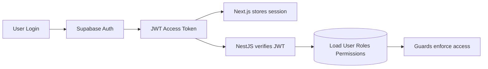
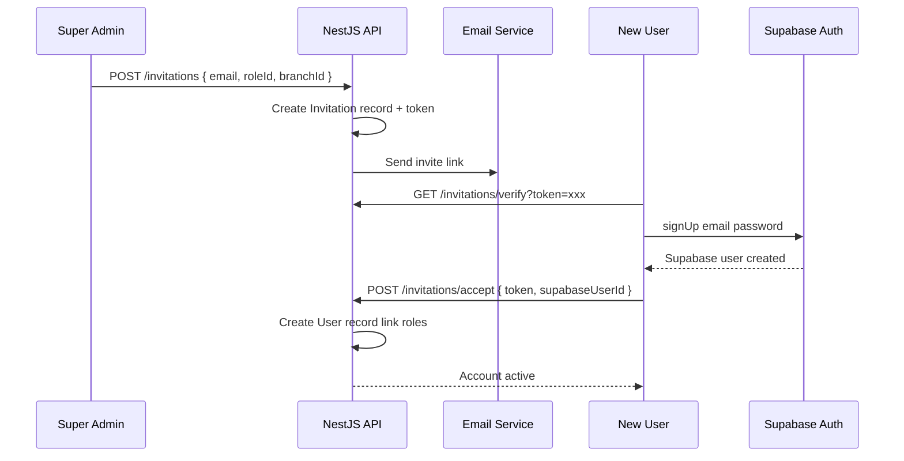

# Authentication & RBAC

## Overview

Authentication is handled by **Supabase Auth**. Authorization (roles, permissions, branch scope) is managed in the **application database** and enforced by **NestJS guards**.



## Authentication Flow

### Login

1. User submits email + password on `/login`
2. Next.js calls `supabase.auth.signInWithPassword()`
3. Supabase returns JWT access token + refresh token
4. Next.js stores session (Supabase client handles refresh)
5. Subsequent API calls include `Authorization: Bearer <access_token>`

### Invitation & Onboarding

From requirements §8:



### Password Reset

1. User requests reset on `/forgot-password`
2. Next.js calls `supabase.auth.resetPasswordForEmail()`
3. Supabase sends reset email
4. User clicks link, sets new password via Supabase

### MFA (Admin Roles)

- Enabled via Supabase Auth TOTP
- Required for roles: `super_admin`, `branch_admin`
- Enforced at login — Supabase returns MFA challenge if enabled
- NestJS checks `amr` claim in JWT for MFA verification

## JWT Verification in NestJS

```typescript
// apps/api/src/common/guards/auth.guard.ts

@Injectable()
export class AuthGuard implements CanActivate {
  async canActivate(context: ExecutionContext): Promise<boolean> {
    const request = context.switchToHttp().getRequest();
    const token = this.extractToken(request);
    if (!token) throw new UnauthorizedException();

    const { data: { user }, error } = await this.supabase.auth.getUser(token);
    if (error || !user) throw new UnauthorizedException();

    const appUser = await this.usersService.findBySupabaseId(user.id);
    if (!appUser?.isActive) throw new UnauthorizedException('Account disabled');

    request.user = appUser;
    request.supabaseUser = user;
    return true;
  }
}
```

## Session Management

| Feature | Implementation |
|---------|----------------|
| Access token | Supabase JWT, short-lived (~1 hour) |
| Refresh token | Supabase handles auto-refresh in client |
| Device tracking | `UserSession` table: device info, last active, IP |
| Forced logout | Revoke Supabase session via admin API |
| Account lockout | Supabase built-in + custom failed-login counter |

### UserSession Model

```prisma
model UserSession {
  id           String   @id @default(cuid())
  userId       String
  supabaseSessionId String?
  deviceInfo   String?
  ipAddress    String?
  lastActiveAt DateTime @default(now())
  createdAt    DateTime @default(now())
}
```

## Role-Based Access Control (RBAC)

### Design Principles

1. **Roles are data** — stored in `Role` table, seeded on deploy, editable by Super Admin
2. **Permissions are granular** — dot-separated codes: `students.create`, `fees.collect`
3. **Roles map to permissions** — `RolePermission` join table
4. **Users can have multiple roles** — `UserRole` with optional `branchId`
5. **No hardcoded role checks** — always check permission codes

### Default Roles (seeded)

| Code | Name | Branch scope |
|------|------|--------------|
| `super_admin` | Super Admin | Institution-wide |
| `branch_admin` | Branch Admin | Single branch |
| `teacher` | Teacher | Single branch |
| `accountant` | Accountant | Single branch |
| `receptionist` | Receptionist | Single branch |
| `parent` | Parent | Linked students |
| `student` | Student | Self only |

### Default Permission Matrix (excerpt)

| Permission | super_admin | branch_admin | teacher | accountant | parent | student |
|------------|:-----------:|:------------:|:-------:|:----------:|:------:|:-------:|
| `branches.manage` | ✓ | | | | | |
| `students.read` | ✓ | ✓ | ✓ | | ✓* | ✓* |
| `students.create` | ✓ | ✓ | | | | |
| `attendance.mark` | ✓ | ✓ | | | | |
| `assessments.marks.enter` | ✓ | ✓ | ✓ | | | |
| `fees.collect` | ✓ | ✓ | | ✓ | | |
| `fees.read` | ✓ | ✓ | | ✓ | ✓* | |
| `reports.view` | ✓ | ✓ | ✓ | ✓ | | |
| `settings.manage` | ✓ | | | | | |

*Scoped to linked/own records only.

### Permission Guard

```typescript
// apps/api/src/common/guards/permissions.guard.ts

@Injectable()
export class PermissionsGuard implements CanActivate {
  constructor(private reflector: Reflector) {}

  async canActivate(context: ExecutionContext): Promise<boolean> {
    const required = this.reflector.get<string[]>('permissions', context.getHandler());
    if (!required?.length) return true;

    const user = context.switchToHttp().getRequest().user as AppUser;
    const userPermissions = await this.getUserPermissions(user.id);

    return required.every(p => userPermissions.includes(p));
  }
}
```

### Usage on Controllers

```typescript
@Controller('students')
@UseGuards(AuthGuard, BranchGuard, PermissionsGuard)
export class StudentsController {
  @Get()
  @Permissions('students.read')
  findAll(@Query() query: ListStudentsQuery, @CurrentUser() user: AppUser) {
    return this.studentsService.findAll(query, user);
  }

  @Post()
  @Permissions('students.create')
  create(@Body() body: CreateStudentInput, @CurrentUser() user: AppUser) {
    return this.studentsService.create(body, user);
  }
}
```

## Branch Scoping

### Branch Guard

```typescript
@Injectable()
export class BranchGuard implements CanActivate {
  async canActivate(context: ExecutionContext): Promise<boolean> {
    const request = context.switchToHttp().getRequest();
    const user = request.user as AppUser;

    if (await this.isSuperAdmin(user)) {
      request.branchId = request.query.branchId ?? request.body?.branchId ?? null;
      return true;
    }

    if (!user.branchId) throw new ForbiddenException('No branch assigned');
    request.branchId = user.branchId;
    return true;
  }
}
```

### Service Layer Enforcement

```typescript
async findOne(id: string, user: AppUser, branchId: string | null) {
  const student = await this.prisma.student.findFirst({
    where: {
      id,
      deletedAt: null,
      ...(branchId ? { branchId } : {}),
    },
  });
  if (!student) throw new NotFoundException();
  return this.toResponse(student);
}
```

## Parent & Student Scoped Access

Parents and students have restricted data access:

| Role | Access rule |
|------|-------------|
| Parent | Only students linked via `StudentParent` where parent user matches |
| Student | Only their own record (`Student.userId` or linked user) |

Implement in service layer with additional filters, not just permission codes.

## Frontend Permission Checks

```typescript
// apps/web/src/hooks/use-permissions.ts

export function usePermissions() {
  const { user } = useAuth();
  const hasPermission = (code: string) => user?.permissions?.includes(code) ?? false;
  return { hasPermission, permissions: user?.permissions ?? [] };
}
```

```tsx
// Conditional UI — hide, don't just disable
{hasPermission('students.create') && (
  <Button onClick={openAdmissionForm}>Admit Student</Button>
)}
```

**Always enforce on API** — frontend checks are UX only.

## Custom Decorators

```typescript
// @CurrentUser() — inject authenticated app user
// @BranchId() — inject resolved branch ID
// @Permissions('students.read') — set required permissions metadata
// @BranchScope() — mark endpoint as branch-scoped
```

## Security Logging

| Event | Logged to |
|-------|-----------|
| Successful login | `AuditLog` + `UserSession` |
| Failed login | `AuditLog` (action: `auth.login_failed`) |
| Permission denied | `AuditLog` (action: `auth.permission_denied`) |
| Role/permission change | `AuditLog` with previous/new values |
| Password reset | `AuditLog` |
| MFA enabled/disabled | `AuditLog` |

## Related Documents

- [07-database-design.md](07-database-design.md) — User, Role, Permission models
- [12-security.md](12-security.md) — broader security requirements
- [09-api-design.md](09-api-design.md) — error responses for 401/403
