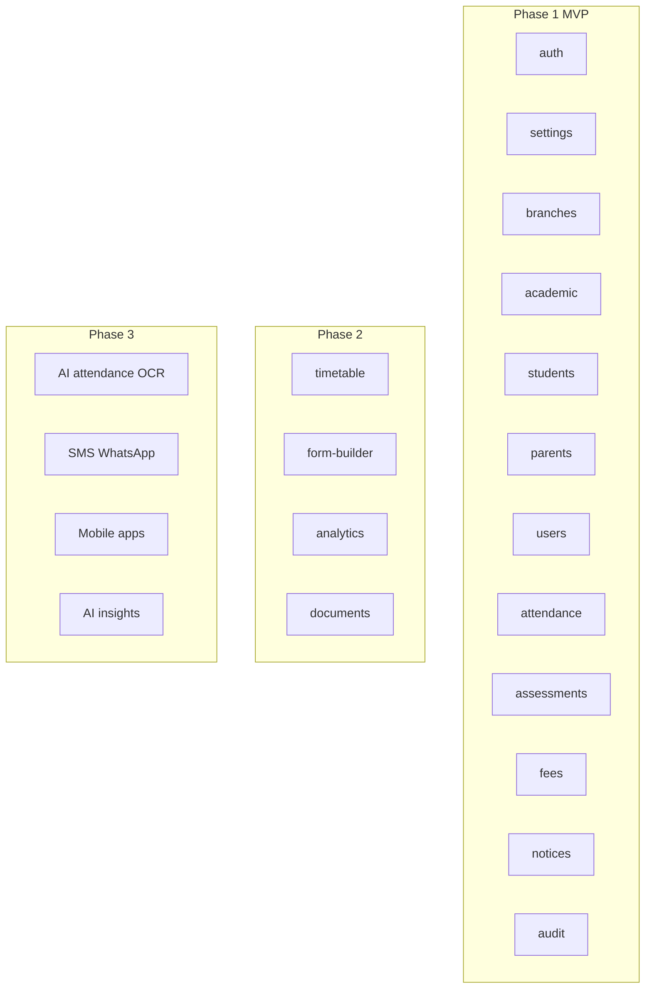

# Feature Modules

Complete module map from the client requirements (ERP-Requirements.docx v1.0), organized by NestJS module with phased delivery.

## Module Overview

---

## Phase 1 — MVP

### auth

**Requirements:** §8 (onboarding), §18 (authentication)

| Feature | Description |
|---------|-------------|
| Login / logout | Supabase Auth integration |
| Password reset | Email-based via Supabase |
| MFA | TOTP for admin roles |
| Session management | List/revoke sessions |
| Current user endpoint | `GET /auth/me` with roles + permissions |

### settings

**Requirements:** White-label, §4 (global structures)

| Feature | Description |
|---------|-------------|
| Institution profile | Name, logo, address, contact, colors |
| Terminology | Batch/Class/Section labels |
| Feature flags | Enable/disable modules |
| Lookup management | Student statuses, attendance statuses |
| System preferences | Timezone, currency, date format |

### branches

**Requirements:** §3

| Feature | Description |
|---------|-------------|
| Create branch | Name, code, address, contact |
| List branches | Super Admin: all; others: assigned |
| Update / deactivate | Soft delete |
| Branch-specific reporting scope | Filter key for all branch-scoped modules |

### academic

**Requirements:** §4

| Feature | Description |
|---------|-------------|
| Programs | Dynamic creation (SSC, HSSC, MDCAT, etc.) |
| Batches | Per program, per branch (Morning, Evening, Weekend) |
| Subjects | Institution-wide, managed by Super Admin |
| Academic sessions | 2026, 2027, etc. with date ranges |
| Batch-subject assignment | Which subjects a batch studies |
| Student-subject assignment | Per-student subject enrollment |

**API paths:** `/programs`, `/batches`, `/subjects`, `/academic-sessions`

### students

**Requirements:** §6

| Feature | Description |
|---------|-------------|
| Student profile | Personal, contact, academic info, photo |
| Admission | Create with program, batch, subjects, status |
| Status management | Active, Inactive, Suspended, Graduated, Transferred, Dropped |
| Search & filter | By name, batch, status, program |
| Custom fields | JSON `customFields` for form-builder data (Phase 2 UI) |
| Soft delete | `deletedAt` — never hard delete |

### parents

**Requirements:** §7

| Feature | Description |
|---------|-------------|
| Parent entity | Separate from student |
| Link to students | Many-to-many via `StudentParent` |
| Relationships | Father, Mother, Guardian |
| One parent → many students | Supported |
| Parent portal access | Phase 1: read-only views for linked students |

### users

**Requirements:** §8 (onboarding workflow)

| Feature | Description |
|---------|-------------|
| Invitation flow | Super Admin / Branch Admin invites by email |
| 10-step onboarding | Branch → Admin → Staff → Students → Parents |
| Role assignment | Via `UserRole` with optional `branchId` |
| Staff management | Create, deactivate, change roles |
| User profile | Name, phone, email, branch assignment |

**Onboarding sequence:**

1. Super Admin creates branch
2. Super Admin creates Branch Admin
3. Invitation email sent
4. Branch Admin activates account
5. Branch Admin creates staff accounts
6. Staff receive invitation emails
7. Student admission completed
8. Parent accounts linked
9. Student and parent invitation emails sent
10. Users create passwords and activate

### attendance

**Requirements:** §9

| Feature | Description |
|---------|-------------|
| Student attendance | Present, Absent, Leave, Late |
| Teacher attendance | Same statuses |
| Staff attendance | Same statuses |
| Mark by date | Office Admin marks for a batch/date |
| Bulk mark | Mark entire batch at once |
| View history | Per student, per date range |

**Statuses:** Stored in `LookupStatus` (category: `attendance_status`), not hardcoded.

### assessments

**Requirements:** §5

| Feature | Description |
|---------|-------------|
| Assessment types | Quiz, Weekly Test, Monthly, FLP, Grand Test, etc. |
| Assessment series | FLP-1, FLP-2, FLP-3, FLP-4, unlimited |
| Create assessment | Type, series, subject, total marks, date |
| Enter marks | Per student, per subject: obtained, percentage, grade, rank |
| Bulk marks entry | Teacher enters for entire batch |
| Remarks | Per record |

### fees

**Requirements:** §11

| Feature | Description |
|---------|-------------|
| Fee types | Admission, Monthly, Registration, Test — configurable |
| Create invoice | Amount, discount, fine, due date |
| Record payment | Mark paid with date |
| Discounts | Manual discount on invoice |
| Scholarships | Flag + amount (basic in Phase 1) |
| Sibling discount | Future: auto-apply based on linked siblings |
| Late fee fines | Manual or auto (Phase 2) |
| Reports | Collection summary, defaulters list |

### notices

**Requirements:** §14

| Feature | Description |
|---------|-------------|
| Create notice | Title, body, recipients |
| Recipients | Students, Parents, Teachers, Staff, Entire Branch |
| Publish / draft | Status management |
| Realtime delivery | Supabase Realtime subscription |
| View for portal users | Parents/students see relevant notices |

### audit

**Requirements:** §17

| Feature | Description |
|---------|-------------|
| Auto-log mutations | Via `AuditService` |
| View logs | Super Admin / Branch Admin |
| Filter | By user, action, entity, date range |
| Immutable | No edit or delete |

---

## Phase 2

### timetable

**Requirements:** §12

| Feature | Description |
|---------|-------------|
| Batch schedules | Weekly recurring slots |
| Subject scheduling | Subject per slot |
| Teacher assignment | Teacher per slot |
| Room assignment | Room/ hall per slot |
| Conflict detection | Teacher conflict, room conflict |
| View | By batch, by teacher, by room |

### form-builder

**Requirements:** §16

| Feature | Description |
|---------|-------------|
| Custom admission fields | Admin creates without code changes |
| Field types | Text, Number, Date, Dropdown, Checkbox, File Upload |
| Examples | Previous School, Board, Emergency Contact |
| Storage | Field definitions in DB; values in `Student.customFields` JSON |
| Render dynamically | Admission form reads field definitions |

### analytics

**Requirements:** §13

| Feature | Description |
|---------|-------------|
| Student analytics | Subject-wise, test-wise performance |
| Attendance trends | Charts over time |
| Progress trends | Improvement/decline detection |
| Rankings | Batch, branch, program rank |
| Weak subject identification | Below threshold alerts |
| Performance alerts | Notify admin/teacher |
| Dashboard KPIs | Tremor cards on admin dashboard |

### documents

**Requirements:** §15

| Feature | Description |
|---------|-------------|
| Document types | Admission forms, B-Form, CNIC, fee receipts, academic records |
| Upload | To Supabase Storage |
| Link to student | `Document` entity with `studentId` |
| Secure access | Signed URLs, permission-checked |
| Categories | Configurable document types |

---

## Phase 3

### AI Attendance (§10)

| Feature | Description |
|---------|-------------|
| Upload register image | Admin uploads photo of attendance register |
| OCR extraction | Extract names/marks from image |
| AI interpretation | Map to student records |
| Suggested attendance | Pre-filled for admin review |
| Human confirmation | Admin must confirm — no auto-submit |

### Communication Integrations (§14)

| Feature | Description |
|---------|-------------|
| Email | Transactional emails (invitations, notices) |
| SMS | Fee reminders, attendance alerts |
| WhatsApp | Notice delivery |

### Mobile Applications (§20)

| App | Users |
|-----|-------|
| Parent App | Attendance, reports, fees, notices |
| Student App | Attendance, reports, timetable |
| Admin App | Branch management on mobile |
| Teacher App | Marks entry, attendance view |

All use the same NestJS API.

### AI Features (§19)

| Feature | Description |
|---------|-------------|
| AI parent performance summaries | Auto-generated report narratives |
| AI student risk detection | Flag at-risk students |
| AI performance trend analysis | Predictive analytics |
| AI academic recommendations | Study suggestions |

---

## Institution Type Variants

Same modules, different defaults:

| Module | Coaching | School | College |
|--------|----------|--------|---------|
| Terminology: batch | Batch | Class | Section |
| Terminology: program | Program | Grade | Degree |
| Assessments | High emphasis | Moderate | High |
| Timetable | Optional | High emphasis | High emphasis |
| Rankings | Batch + branch + program | Class rank | Semester rank |
| Fee types | Test fee, monthly | Tuition, transport | Semester fee |

Configured via `InstitutionSettings.institutionType` and `terminology` / `featureFlags`.

---

## API Module → Path Reference

| NestJS Module | API Base Path | Phase |
|---------------|---------------|-------|
| settings | `/settings` | 1 |
| branches | `/branches` | 1 |
| academic | `/programs`, `/batches`, `/subjects`, `/academic-sessions` | 1 |
| students | `/students` | 1 |
| parents | `/parents` | 1 |
| users | `/users`, `/invitations` | 1 |
| attendance | `/attendance` | 1 |
| assessments | `/assessments`, `/assessment-records` | 1 |
| fees | `/fee-types`, `/fee-invoices` | 1 |
| notices | `/notices` | 1 |
| audit | `/audit-logs` | 1 |
| timetable | `/timetable` | 2 |
| form-builder | `/form-fields` | 2 |
| analytics | `/analytics` | 2 |
| documents | `/documents` | 2 |

## Related Documents

- [01-product-vision.md](01-product-vision.md) — product goals and phases
- [04-monorepo-structure.md](04-monorepo-structure.md) — module folder layout
- [11-backend-guidelines.md](11-backend-guidelines.md) — module implementation patterns
