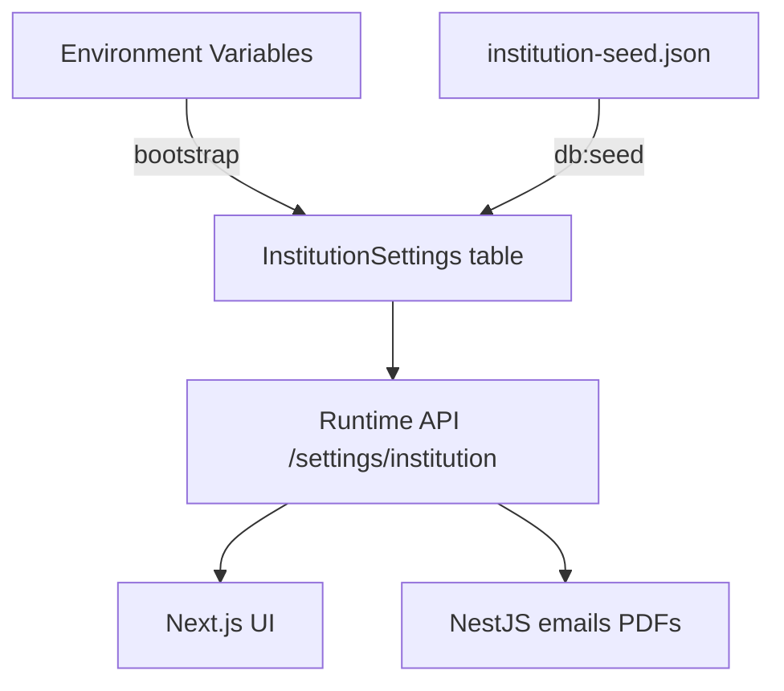

# White-Label Configuration

## Overview

Every deployment is branded via configuration — never via code changes. Institution name, logo, address, contact, colors, and terminology all come from a single configuration layer.

## Configuration Surfaces



| Surface | When set | Mutable at runtime? |
|---------|----------|---------------------|
| Environment variables | Deploy time | No (requires redeploy) |
| Seed JSON file | `db:seed` | No (re-seed overwrites) |
| `InstitutionSettings` DB | Seed + admin UI | Yes (Super Admin) |

## InstitutionSettings Schema

```typescript
interface InstitutionSettings {
  id: string;                    // Always "default" — one row per deployment
  name: string;                  // "Nexium Academy Pakistan"
  logoUrl: string | null;        // Supabase Storage URL
  faviconUrl: string | null;
  primaryColor: string;          // "#1e40af" — hex
  address: string | null;
  city: string | null;
  province: string | null;
  country: string;               // "Pakistan"
  phone: string | null;          // "+92..."
  email: string | null;
  website: string | null;        // "https://..."
  timezone: string;              // "Asia/Karachi"
  currency: string;              // "PKR"
  institutionType: InstitutionType;
  terminology: TerminologyMap;
  featureFlags: FeatureFlags;
}
```

## Environment Variables

```bash
# Required at deploy time
INSTITUTION_NAME="Your Institution Name"
INSTITUTION_TYPE="coaching"          # coaching | school | college
INSTITUTION_TIMEZONE="Asia/Karachi"

# URLs
NEXT_PUBLIC_APP_URL="https://erp.institution.pk"
NEXT_PUBLIC_API_URL="https://api.institution.pk"
```

Env vars provide fallback values before DB seed runs and for SSR metadata.

## Institution Type Profiles

### coaching (default for nexium)

```json
{
  "institutionType": "coaching",
  "terminology": {
    "batch": "Batch",
    "program": "Program",
    "assessment": "Test",
    "session": "Session"
  },
  "featureFlags": {
    "timetable": false,
    "formBuilder": false,
    "aiAttendance": false,
    "parentPortal": true,
    "studentPortal": true,
    "rankings": true,
    "assessmentSeries": true
  }
}
```

### school

```json
{
  "institutionType": "school",
  "terminology": {
    "batch": "Class",
    "program": "Grade",
    "assessment": "Exam",
    "session": "Academic Year"
  },
  "featureFlags": {
    "timetable": true,
    "formBuilder": true,
    "aiAttendance": false,
    "parentPortal": true,
    "studentPortal": true,
    "rankings": true,
    "assessmentSeries": false
  }
}
```

### college

```json
{
  "institutionType": "college",
  "terminology": {
    "batch": "Section",
    "program": "Degree Program",
    "assessment": "Exam",
    "session": "Semester"
  },
  "featureFlags": {
    "timetable": true,
    "formBuilder": true,
    "aiAttendance": false,
    "parentPortal": true,
    "studentPortal": true,
    "rankings": true,
    "assessmentSeries": true
  }
}
```

## Logo & Favicon

### Upload Flow

1. Place logo file in seed assets or upload via Super Admin settings UI
2. Upload to Supabase Storage bucket `logos/default/logo.png`
3. Store public URL in `InstitutionSettings.logoUrl`
4. Frontend reads URL at runtime — no build-time embedding

### Recommended Sizes

| Asset | Size | Format |
|-------|------|--------|
| Logo (sidebar) | 128×128 px | PNG with transparency |
| Logo (login) | 256×256 px | PNG |
| Favicon | 32×32 px | ICO or PNG |

## Theme Colors

Primary color applied via CSS variable at runtime:

```typescript
// Set from InstitutionSettings.primaryColor
document.documentElement.style.setProperty('--institution-primary', settings.primaryColor);
```

Tailwind config maps institution color:

```css
.btn-primary {
  background-color: var(--institution-primary);
}
```

Super Admin can preview and change color in settings without redeployment.

## Feature Flags

Control module visibility per deployment:

| Flag | Effect when `false` |
|------|---------------------|
| `timetable` | Hide timetable nav, disable API routes |
| `formBuilder` | Use fixed admission form only |
| `aiAttendance` | Hide OCR upload option |
| `parentPortal` | Disable parent login and views |
| `studentPortal` | Disable student login and views |
| `rankings` | Hide rank columns in assessment views |
| `assessmentSeries` | Hide series grouping |

Check flags in both frontend (hide nav) and backend (reject requests):

```typescript
if (!settings.featureFlags.timetable) {
  throw new ForbiddenException('Timetable module is not enabled');
}
```

## What to Change for a New Customer

| Field | Change? |
|-------|---------|
| `name` | Yes |
| `logoUrl` / `faviconUrl` | Yes |
| `address`, `city`, `province` | Yes |
| `phone`, `email`, `website` | Yes |
| `institutionType` | Yes |
| `primaryColor` | Optional |
| `terminology` | Optional (defaults per type) |
| `featureFlags` | Optional |
| Source code | **No** |
| API routes | **No** |
| Database schema | **No** |

## Admin Settings UI (Phase 1)

Super Admin can edit at `/settings/institution`:

- Institution name
- Logo upload
- Address and contact
- Primary color picker
- Terminology overrides
- Feature flag toggles

Changes saved to `InstitutionSettings` and reflected immediately (TanStack Query cache invalidation).

## Code Rules

### Do

```typescript
const { name, logoUrl } = useInstitution();
return <h1>{name}</h1>;
```

### Do Not

```typescript
const INSTITUTION_NAME = 'Nexium Academy Pakistan'; // NEVER
if (settings.name === 'nexium') { /* special logic */ } // NEVER
```

## Template Files

| File | Purpose |
|------|---------|
| [templates/institution-seed.example.json](templates/institution-seed.example.json) | Blank template for new customers |
| [templates/nexium.institution.json](templates/nexium.institution.json) | Nexium Academy reference config |

## Related Documents

- [17-clone-and-rebrand.md](17-clone-and-rebrand.md) — step-by-step rebrand process
- [10-frontend-guidelines.md](10-frontend-guidelines.md) — theming implementation
- [15-deployment.md](15-deployment.md) — deploy-time configuration
