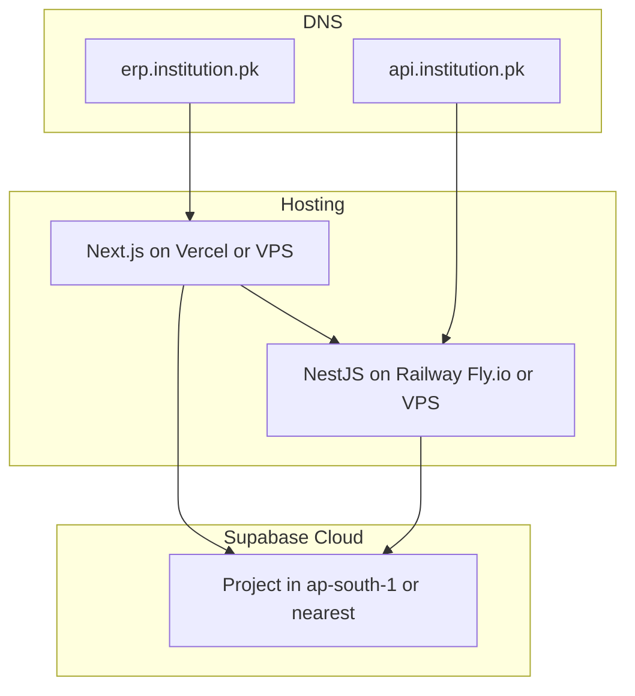

# Deployment

## Deployment Model

Each institution gets an **independent deployment**:

- Dedicated Supabase project (PostgreSQL, Auth, Storage, Realtime)
- Dedicated API server (NestJS)
- Dedicated web app (Next.js)
- Custom domain

No shared infrastructure between customers.

## Architecture Per Deployment



## Recommended Hosting

| Component | Option A (PaaS) | Option B (VPS) |
|-----------|-----------------|----------------|
| Web (Next.js) | Vercel | Same VPS as API |
| API (NestJS) | Railway or Fly.io | DigitalOcean / Hetzner VPS |
| Database | Supabase Cloud | Supabase Cloud |
| Storage | Supabase Storage | Supabase Storage |

**Supabase region:** Choose closest to Pakistan — `ap-south-1` (Mumbai) or `ap-southeast-1` (Singapore).

## First Deployment: Nexium Academy

### Step 1 — Supabase Project

1. Create new project at [supabase.com](https://supabase.com)
2. Note: Project URL, anon key, service role key, database URL
3. Enable Auth → Email provider
4. Configure Auth → URL: `https://erp.nexium.edu.pk` (or actual domain)
5. Enable MFA in Auth settings

### Step 2 — Storage Buckets

Create buckets in Supabase Dashboard → Storage:

| Bucket | Public | Max size |
|--------|--------|----------|
| `logos` | Yes | 2 MB |
| `student-photos` | No (signed URLs) | 5 MB |
| `documents` | No (signed URLs) | 10 MB |

### Step 3 — Database Setup

```bash
# Clone repo, install deps
pnpm install

# Configure API env
cp docs/templates/.env.api.example apps/api/.env
# Fill in DATABASE_URL, SUPABASE_*, etc.

# Run migrations
pnpm db:migrate

# Seed with nexium config
pnpm db:seed -- --config docs/templates/nexium.institution.json
```

### Step 4 — Upload Logo

```bash
# Upload nexium logo to Supabase Storage
# logos/default/logo.png
# Update InstitutionSettings.logoUrl via seed or admin UI
```

### Step 5 — Deploy API

```bash
# Build
pnpm --filter @eims/api build

# Deploy to Railway/Fly.io/VPS
# Set all env vars from docs/templates/.env.api.example
```

### Step 6 — Deploy Web

```bash
# Build
pnpm --filter @eims/web build

# Deploy to Vercel or VPS
# Set env vars from docs/templates/.env.web.example
```

### Step 7 — DNS

| Record | Type | Value |
|--------|------|-------|
| `erp` | CNAME | Vercel/hosting target |
| `api` | CNAME | API hosting target |

### Step 8 — Initial Admin Setup

1. Seed creates Super Admin invitation or use seed script to create first user
2. Super Admin logs in, verifies institution branding
3. Create first branch
4. Invite Branch Admin
5. Complete onboarding flow (see [13-feature-modules.md](13-feature-modules.md))

### Step 9 — Verification Checklist

- [ ] Login page shows correct institution name and logo
- [ ] API health check responds
- [ ] Super Admin can create branch
- [ ] Invitation email sends
- [ ] Student admission works end-to-end
- [ ] HTTPS on all endpoints
- [ ] MFA works for admin account

## Environment Variables

See template files:

- [templates/.env.api.example](templates/.env.api.example)
- [templates/.env.web.example](templates/.env.web.example)

## CI/CD (GitHub Actions)

```yaml
# .github/workflows/ci.yml
name: CI
on: [pull_request, push]
jobs:
  lint-and-test:
    runs-on: ubuntu-latest
    steps:
      - uses: actions/checkout@v4
      - uses: pnpm/action-setup@v4
      - uses: actions/setup-node@v4
        with: { node-version: 20, cache: pnpm }
      - run: pnpm install
      - run: pnpm lint
      - run: pnpm test
      - run: pnpm build
```

### Deploy Workflow (per customer)

Trigger deploy on release tag (`v1.0.0`):

1. Build web + api
2. Deploy to customer's hosting
3. Run migrations against customer's Supabase
4. Do **not** re-seed (would overwrite data)

## Database Migrations in Production

```bash
# Production migration (no interactive prompts)
pnpm --filter @eims/database exec prisma migrate deploy
```

- Run migrations before deploying new API version
- Never run `migrate dev` in production
- Always backup before migration

## Monitoring (Recommended)

| Tool | Purpose |
|------|---------|
| Supabase Dashboard | DB metrics, auth logs, storage usage |
| Hosting platform logs | API errors, response times |
| Sentry (optional) | Error tracking for web + api |
| Uptime monitor | Ping `/api/v1/health` every 5 min |

### Health Endpoint

```
GET /api/v1/health
→ { "status": "ok", "timestamp": "..." }
```

## Backup Strategy

| What | How | Frequency |
|------|-----|-----------|
| Database | Supabase automated backups (Pro plan) or `pg_dump` | Daily |
| Storage | Supabase bucket replication or periodic sync | Weekly |
| Code | Git repository | Every commit |

## Scaling Notes

For typical coaching center / school (100–5000 students):

- Supabase free/pro tier is sufficient
- Single API instance handles load
- Vercel handles web scaling automatically

Upgrade when: \>10k students, \>100 concurrent users, or heavy reporting.

## Related Documents

- [17-clone-and-rebrand.md](17-clone-and-rebrand.md) — deploying for a new customer
- [14-white-label-config.md](14-white-label-config.md) — configuration details
- [12-security.md](12-security.md) — deployment security checklist
- [templates/](templates/) — env and seed templates
