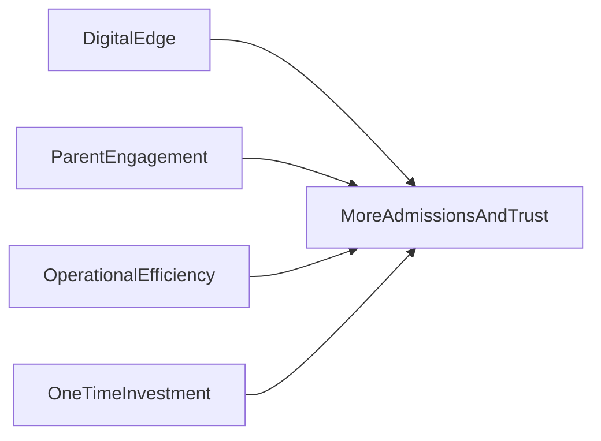

# Client Marketing Brochure — Design Brief

Creative brief for designers and AI layout tools. Use this document to produce a **print-ready PDF brochure** (and optional social crops) that Nexium Technologies can send to prospective school, college, and coaching center clients.

**This is not the final brochure** — it is the spec: copy, layout zones, stats, visuals, and compliance notes.

---

## How to use this brief

| Rule | Detail |
|------|--------|
| Copy blocks | Final-draft — paste directly unless sales requests edits |
| Stats marked `[ILLUSTRATIVE]` | Must include footnote: *"Typical results reported by digitized institutions; individual outcomes vary."* |
| Stats marked `[FACTUAL]` | Safe to print without disclaimer |
| Product UI | Reference [ui-ux-page-inventory.md](ui-ux-page-inventory.md) for screen layouts; do not invent features |
| Live demo | See [demo-seed.md](demo-seed.md) for test accounts and screenshots |
| Logo | Obtain **Nexium Technologies logo** from client — not stored in this repo |

---

## 1. Project overview

| Field | Value |
|-------|-------|
| **Client (vendor)** | Nexium Technologies |
| **Product** | Educational Institution Management System (EIMS) |
| **Website** | https://www.nexiumtechnologies.com/ |
| **Phone** | +92 336 9701396 |
| **Email** | ibraheem45622@gmail.com |
| **Audience** | Owners, principals, and branch heads at Pakistani **schools**, **colleges**, and **coaching centers** |
| **Primary emphasis** | Parent portal and student portal — engagement that turns families into informal ambassadors |
| **Deliverable** | 1-page (A4 or Letter, front only) **or** 2-page (front + back) — designer selects best fit |
| **Output formats** | Print-ready PDF (300 DPI) + optional 1080×1080 social square excerpt |
| **Language** | English primary; optional Urdu sub-headline under hero (see §11) |
| **Tone** | Confident, modern, institution-focused — benefit-led, not technical |
| **Visual style** | Clean ed-tech / SaaS; white-label institution branding; subtle Pakistan context (PKR, +92) |

---

## 2. Core messaging framework

### Four pillars

Repeat these themes across the brochure — hero, body, and close.

| Pillar | Message | Product proof |
|--------|---------|---------------|
| **Digital edge** | New-generation parents choose institutions with strong digital presence — they expect transparency on their phone, not paper diaries | Branded mobile-ready parent/student web portal; institution name and logo on every screen |
| **Parent engagement → ambassadors** | Informed parents talk positively at work, in WhatsApp groups, and at family gatherings | Real-time notices, attendance, marks, fees, timetable, AI performance summaries |
| **Operational efficiency** | Staff spend less time on registers, phone calls, and spreadsheets | Dashboard KPIs, bulk attendance, bulk marks, defaulter lists, SMS/WhatsApp reminders, AI attendance OCR |
| **One-time investment** | Own your deployment — your brand, your domain, your data | White-label per institution; dedicated database; not shared multi-tenant SaaS |

### Messaging flow



### Tagline options (pick one for hero)

1. **"Turn parents into your strongest marketing channel."** *(recommended)*
2. "The digital campus your families expect — and your staff deserves."
3. "One platform. Every branch. Parents who proudly recommend you."

### Elevator pitch (~40 words)

> White-label ERP for Pakistani schools, colleges, and coaching centers — from admissions to fees, with parent and student portals that keep families informed, engaged, and talking about your institution for the right reasons.

### Product name on brochure

**Primary:** Educational Institution Management System  
**Short:** Institution ERP / Campus Management Platform  
**Vendor line:** *Powered by Nexium Technologies*

---

## 3. Layout options

### Option A — Single page (front only, dense)

Best for: quick handouts, event tables, WhatsApp PDF share.

| Zone | Content | Approx. height |
|------|---------|----------------|
| **Header** | Nexium logo + product name + hero headline + subhead | 15% |
| **Hero visual** | Parent portal on phone + staff dashboard on laptop | 25% |
| **Stat band** | 3 large numbers (see §5) | 10% |
| **Feature grid** | 6 icons × title + one-line benefit | 20% |
| **Parent story strip** | Short narrative + one pull quote | 15% |
| **Why now** | 2–3 urgency bullets | 8% |
| **Footer CTA** | Book demo + website + phone + email + QR | 7% |

### Option B — Two pages (recommended)

Best for: sales meetings, email attachments, all institution types.

**Page 1 — Emotional + strategic** *(sells the feeling)*

| Zone | Content |
|------|---------|
| Hero | Headline + parent ambassador sub-story |
| Problem → solution | Paper chaos vs connected campus (2-column) |
| Stat band | Up to 5 numbers |
| Portal highlight | Largest visual — parent portal on phone mockup with 4–6 feature callouts |
| Student portal | Smaller inset — "Students stay informed too" |

**Page 2 — Rational + close** *(sells the decision)*

| Zone | Content |
|------|---------|
| Feature blocks | 5 grouped modules (§6) — icon grid |
| Control & trust strip | Security, MFA, audit, white-label |
| Institution types | School \| College \| Coaching callout boxes |
| One-time investment | 4 bullets + soft CTA |
| Testimonial placeholder | Quote block |
| Footer | Full contact + QR + secondary CTAs |

**Designer note:** Page 1 = emotion and parent story. Page 2 = features, ROI, and close.

---

## 4. Parent ambassador narrative

### Suggested hero visual

Parent at school gate or family setting, looking at phone showing **Parent portal** screen: child name, recent attendance, assessment grade, fee balance. Warm, trustworthy, Pakistani context.

### Story arc (brochure body copy — paste ready)

> When a parent opens their phone and sees today's attendance, this week's test result, and the fee receipt — they don't stay silent. They share screenshots with relatives. They compare notes with other parents. They recommend schools that *keep them in the loop*.
>
> Your institution becomes part of their daily conversation — not because you asked them to advertise, but because you gave them something worth talking about.

### Pull quotes (use as callout boxes or icon captions)

| Label | Quote |
|-------|-------|
| **The WhatsApp moment** | "Aisha's school sent her Ali's FLP result before she even reached home." |
| **The admission referral** | "My cousin enrolled because I showed her the parent portal — she said it felt like a modern school." |
| **The trust dividend** | "No more calling the office for every update. That trust shows up in fee payments on time." |

### Problem → solution arc (two-column block)

**The old way**

- Registers and diaries that never leave the office
- Parents calling reception for every mark and absence
- Fee reminders on paper that get lost
- Word-of-mouth limited to "I heard they're good" — with no proof

**The connected campus**

- Parents see attendance, marks, fees, and notices on their phone — 24/7
- Staff mark attendance and enter marks once — families see it instantly
- SMS and WhatsApp reminders for overdue fees
- Parents who feel informed become parents who recommend you

### Parent portal — benefit table

Design as feature list beside phone mockup.

| Portal feature | Parent benefit | Ambassador effect |
|----------------|----------------|-------------------|
| **Live notices** | Never miss holidays, exams, or events | Parents forward notices in family WhatsApp groups |
| **Attendance history** | See absences the same day | Transparency reduces disputes; builds reputation |
| **Assessments & grades** | Marks without waiting for report day | Pride-sharing drives word-of-mouth |
| **Fee visibility** | Outstanding balance and payment status | Fewer surprises; faster payments |
| **Class timetable** | Know where and when classes happen | Positions institution as organized and professional |
| **AI performance summary** | Plain-language insight on child's progress | Differentiator parents mention to other families |

### Student portal (secondary callout)

**Headline:** Students stay informed too.

**Body:** Students see their own attendance, assessments, timetable, and fee status on a mobile-ready portal — building responsibility and reducing "I didn't know" excuses.

**Do not say:** "Download our app" — use **"mobile-ready parent portal"** (responsive web; native apps are roadmap).

---

## 5. Attention-grabbing numbers

### Designer rules

- Use **3 stats max** on a 1-pager; **up to 5** on a 2-pager
- Large typography: numbers at **48–72pt**, label at 12–14pt
- `[ILLUSTRATIVE]` stats require asterisk + footnote
- `[FACTUAL]` stats need no disclaimer

### Tier A — Illustrative benchmarks `[ILLUSTRATIVE]*`

| Display | Label | Supporting one-liner |
|---------|-------|----------------------|
| **70%** | Less manual admin time | Digital attendance, records, and reminders vs paper registers |
| **40%** | Faster fee collection | Defaulter tracking + SMS/WhatsApp payment reminders |
| **3×** | More parent touchpoints | Portal + notices vs occasional parent-teacher meetings |
| **24/7** | Parent access to updates | Portal always on — office hours stay the same |
| **0** | Shared databases with other schools | Your institution gets its own dedicated deployment |

**Required footnote:**  
\* *Typical results reported by digitized institutions; individual outcomes vary.*

### Tier B — Product facts `[FACTUAL]`

Use as smaller trust badges or icon row — no asterisk needed.

| Fact | Display text |
|------|--------------|
| Multi-branch | **Unlimited branches** — one system, strict data isolation |
| Roles | **7 user roles** — Admin, Teacher, Accountant, Receptionist, Parent, Student, and more |
| Pakistan-ready | **Built for Pakistan** — PKR, +92, CNIC/B-Form |
| Security | **Admin MFA + audit logs** — enterprise-grade accountability |
| AI | **AI attendance OCR + at-risk insights** — smart tools, human confirmation |

### Suggested stat combinations

**1-pager (pick 3):** 70% admin time · 3× parent touchpoints · 24/7 access  
**2-pager (pick 5):** 70% · 40% · 3× · 24/7 · 0 shared databases

---

## 6. Feature → benefit matrix

Group into **5 brochure blocks** on Page 2. Each block: icon + headline + 2 benefit bullets.

### A. Admissions & records

**Headline:** Every student, one digital file.

- Complete profiles with photo, contact, CNIC/B-Form, and academic assignment
- Custom admission forms and document vault — B-Form, CNIC, fee receipts, academic records

**Benefit line:** Faster admissions. Nothing lost in a drawer.

---

### B. Daily operations

**Headline:** Replace the register room.

- Student, teacher, and staff attendance — bulk mark entire batches in seconds
- Weekly timetable with conflict detection; notices published to staff and portals in real time

**Benefit line:** One screen instead of five registers.

---

### C. Academics & performance

**Headline:** Results that speak for themselves.

- Programs, batches, subjects, and sessions — configured for schools, colleges, or coaching
- Assessments, marks entry, rankings, weak-subject alerts, and exportable analytics

**Benefit line:** Track FLP, mock tests, or class exams — without Excel chaos.

---

### D. Finance

**Headline:** Fees collected, parents informed.

- Fee types, invoices, discounts, late fines, and payment recording
- Defaulter reports and collection summaries — parents see dues in their portal

**Benefit line:** Clear cash flow. Fewer awkward phone calls.

---

### E. Engagement & intelligence

**Headline:** Families connected. Leadership informed.

- Mobile-ready **parent portal** and **student portal** — attendance, marks, fees, timetable, notices
- SMS and WhatsApp messaging; AI at-risk student detection; AI attendance register scan

**Benefit line:** Parents stay in the loop. You spot problems early.

---

### F. Control & trust (footer strip)

**Headline:** Your institution. Your data. Your brand.

- Role-based permissions for every staff member; branch-level data isolation
- Immutable audit trail; two-factor authentication for admins; white-label branding on every screen

**Benefit line:** Professional, secure, and entirely yours.

---

## 7. "Why now" — competitive urgency

Use as bullet block or sidebar on Page 1.

- **New-generation parents** research schools on their phone before visiting campus — digital presence is the first impression.
- **Coaching centers** compete on results *and* experience — portals that show FLP and mock performance win trust before admission day.
- **Multi-branch groups** need one system, not separate WhatsApp chaos per campus.
- **Admissions season** favors institutions parents can *show* to relatives — a live portal beats a brochure every time.
- **One-time deployment** — your brand, your domain, your database; not a generic third-party logo on your families' screens.

---

## 8. One-time investment positioning

### Headline options

- "A one-time investment in the campus parents expect."
- "Own your digital campus — not rent it seat by seat."

### Body copy (paste ready)

> Nexium deploys a **complete, independent system** for your institution — your name, your logo, your colors, and your own database. No shared tenant with competing schools. No per-student fees that grow every year.
>
> You get a long-term digital asset: the same platform that powers admissions, academics, fees, and parent engagement today — with a clear path to ongoing upgrades.

### Bullets

- **Your branding** on staff dashboard, parent portal, and student portal
- **Your data** in a dedicated deployment — not mixed with other institutions
- **Your branches** under one roof — Islamabad, Lahore, or nationwide
- **Your edge** in an era where parents choose schools they can see on a screen

### CTA line

> **Request a walkthrough with your institution's name and logo on screen.**

**Do not include** specific PKR pricing or "free forever" claims unless sales provides an approved pricing insert.

---

## 9. Institution types (callout boxes)

Three equal boxes for Page 2 — show the product adapts.

| Type | Headline | One-liner |
|------|----------|-----------|
| **Schools** | Primary & secondary | Classes, timetables, parent engagement, tuition management |
| **Colleges** | Intermediate & degree | Sections, semesters, subject groups, session tracking |
| **Coaching centers** | Test prep & evening coaching | Batches, FLP series, rankings, mock test analytics |

**Shared line under boxes:** Same platform. Terminology and modules adapt to your institution type.

---

## 10. Visual direction

| Element | Instruction |
|---------|-------------|
| **Color palette** | Nexium brand primary + white + neutral grays; show white-label sample with "Your School Name" and institution primary color |
| **Photography** | Pakistani school/coaching settings; parents and students with smartphones; diverse, warm, professional — avoid generic Western stock |
| **Product mockups** | Parent portal (phone): welcome, child card, attendance list, marks, fees — see [ui-ux-page-inventory.md §7.2](ui-ux-page-inventory.md#72-parent-portal). Dashboard (laptop): KPI cards — see [§6.1](ui-ux-page-inventory.md#61-dashboard-overview) |
| **Icons** | Clean line icons (clipboard, wallet, bell, calendar, sparkles for AI) — match app Lucide style |
| **Diagram** | Simple flow: **Staff Dashboard** → **Your Platform** → **Parent Phone** |
| **Logo placement** | Nexium logo top-left or footer; institution white-label logo on phone mockup screen |
| **QR code** | Link to https://www.nexiumtechnologies.com/ or demo booking page |

### Do

- Show real UI structure from product inventory doc
- Use large numbers for stats
- Leave whitespace — brochure should feel premium, not crowded
- Include Pakistani context subtly (PKR symbol, +92 phone format)

### Do not

- Invent UI screens that don't exist
- Use dark "hacker" aesthetic
- List 20+ features in small text
- Claim "download our mobile app" (say "mobile-ready portal")
- Use illustrative stats without footnote

---

## 11. Optional extras

| Extra | Instruction |
|-------|-------------|
| **Urdu sub-headline** | Under English hero: e.g. *"والدین کو آپ کی بہترین تشہیر بنائیں"* — verify translation with native speaker before print |
| **Testimonial** | Placeholder: *"[Institution Name] — [City]"* + 2 lines of praise; replace with Nexium Academy quote only if approved |
| **Social crop** | 1080×1080: hero headline + one stat + Nexium logo + CTA |
| **Back cover (print)** | Contact block only — minimal, elegant |

---

## 12. Calls to action and contact block

### Primary CTA (large button / bold text)

**Book a free demo**

### Secondary CTAs

- See the parent portal live
- Deploy with your branding in weeks, not months

### Footer block (fixed copy)

```
Nexium Technologies
Educational Institution Management System

Book a free demo
https://www.nexiumtechnologies.com/
+92 336 9701396
ibraheem45622@gmail.com

[QR code]
```

---

## 13. Compliance and honesty notes

**Designer and sales must read before print.**

| Topic | Rule |
|-------|------|
| Illustrative stats | Always asterisk + footnote (see §5) |
| AI features | Shipped in product; SMS/WhatsApp require Twilio configuration |
| Mobile apps | Say **"mobile-ready parent portal"** — native apps are roadmap, not current deliverable |
| Reference client | "Nexium Academy" only if explicitly approved for marketing |
| Pricing | No PKR amounts unless sales inserts approved pricing sheet |
| Uptime / SLA | Do not promise specific uptime percentages without legal approval |

---

## 14. Copy deck

Paste-ready text with character guidance for layout.

| ID | Element | Copy | Char limit |
|----|---------|------|------------|
| H1 | Hero headline | Turn parents into your strongest marketing channel. | 55 |
| H1-alt | Hero headline alt | The digital campus your families expect — and your staff deserves. | 65 |
| SH1 | Hero subhead | White-label ERP for Pakistani schools, colleges, and coaching centers — with parent and student portals that keep families informed and talking about you. | 140 |
| ST1 | Stat 1 | 70% less manual admin time* | 30 |
| ST2 | Stat 2 | 40% faster fee collection* | 30 |
| ST3 | Stat 3 | 3× more parent touchpoints* | 30 |
| ST4 | Stat 4 | 24/7 parent access | 20 |
| ST5 | Stat 5 | 0 shared databases | 22 |
| FN1 | Footnote | *Typical results reported by digitized institutions; individual outcomes vary. | 75 |
| P1 | Parent story (short) | When a parent sees today's attendance and this week's result on their phone, they share it. Your institution becomes part of their conversation — because you gave them something worth talking about. | 200 |
| Q1 | Pull quote 1 | "She sent me Ali's FLP result before I even reached home." | 55 |
| Q2 | Pull quote 2 | "My cousin enrolled after I showed her the parent portal." | 50 |
| Q3 | Pull quote 3 | "No more calling the office. That trust shows up in fee payments." | 55 |
| W1 | Why now 1 | New-generation parents research schools on their phone first. | 55 |
| W2 | Why now 2 | Coaching centers win on results *and* the parent experience. | 50 |
| W3 | Why now 3 | Multi-branch groups need one system — not WhatsApp per campus. | 55 |
| I1 | Investment headline | A one-time investment in the campus parents expect. | 50 |
| I2 | Investment body | Your name. Your logo. Your database. A complete deployment — not rented SaaS that grows more expensive every year. | 120 |
| CTA1 | Primary CTA | Book a free demo | 20 |
| CTA2 | Secondary CTA | See the parent portal live | 28 |
| CTA3 | Secondary CTA | Request a walkthrough with your logo on screen | 45 |
| FT1 | Footer vendor | Nexium Technologies | 20 |
| FT2 | Footer product | Educational Institution Management System | 45 |
| FT3 | Footer web | www.nexiumtechnologies.com | 30 |
| FT4 | Footer phone | +92 336 9701396 | 18 |
| FT5 | Footer email | ibraheem45622@gmail.com | 25 |

---

## 15. Designer pre-print checklist

- [ ] Nexium Technologies logo placed (high-res asset from client)
- [ ] Hero headline and subhead from copy deck (§14)
- [ ] Parent portal mockup matches real UI sections (not fabricated)
- [ ] 3–5 stats with correct `[ILLUSTRATIVE]` footnote if used
- [ ] Parent ambassador story or pull quote visible on Page 1
- [ ] All 5 feature blocks (§6) on Page 2 or condensed grid on 1-pager
- [ ] School / College / Coaching callouts present
- [ ] "Mobile-ready portal" wording — not "download app"
- [ ] Primary CTA: Book a free demo
- [ ] Contact: website, +92 336 9701396, ibraheem45622@gmail.com
- [ ] QR code tested and scannable
- [ ] Print bleed 3mm; safe margin 12mm minimum
- [ ] No pricing unless sales approved insert attached
- [ ] Urdu text proofread if included

---

## 16. Reference links

| Document | Use for |
|----------|---------|
| [ui-ux-page-inventory.md](ui-ux-page-inventory.md) | Screen layouts, portal sections, dashboard KPIs |
| [demo-seed.md](demo-seed.md) | Live demo logins for screenshots |
| [01-product-vision.md](01-product-vision.md) | White-label model, institution types, Pakistan context |
| [13-feature-modules.md](13-feature-modules.md) | Full feature list by phase — do not claim unshipped modules |

---

*Brief version 1.0 — Nexium Technologies. For internal sales and design use.*
