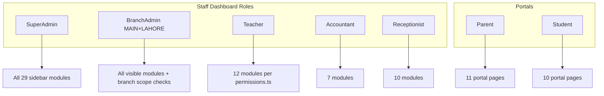

# E2E Run 02 — Multi-Portal Testing Plan

## Why you provided the issue list (core concern)

Run 01 and your manual testing so far covered **Super Admin only**, module-by-module, with **deep interaction** — not just “page loads.” You clicked filters, searched by ID, opened modals, checked validation messages, compared table UI, verified pagination, exercised More menus, and noted layout inconsistencies.

**The issue list you provided is not only a fix backlog.** It is the **quality bar and testing pattern** Run 02 must apply everywhere:

- Apply the **same depth of scrutiny** to **Teacher, Branch Admin (MAIN + LAHORE), Accountant, Receptionist, Parent, and Student** portals — not only Super Admin.
- For **every module** each role can access, test the same categories you checked manually: **search/filter behavior, ID columns, pagination (API + UI), form validation, modals vs in-row edit, confirmation popups vs alerts, stat cards, More-menu actions, layout consistency, console/network errors.**
- For modules **you did not test yet** (Analytics, Reports, Leave requests, Front office, Library, Accounting, Certificates, Transport, Biometric, Payroll, and full portal pages), run the **same kind of pass** and log anything that would belong on your list if you had opened that screen.
- **Re-verify every item below** on Super Admin (regression). **Also hunt for the same class of defect** on other roles — e.g. if Students search-by-ID is broken for SA, check whether Parent portal search, Users search-by-`STF-*`, etc. fail similarly on pages that role can reach.

Run 02 succeeds when we have a bug/issue log as detailed as your Super Admin notes, but **scoped across all 8 accounts and every reachable module** — plus additional cases the tester discovers using the same checklist.

---

## Goal

Produce a **detailed, executable testing plan** for Run 02 that:

1. Tests **every role** (Super Admin, Branch Admin MAIN/LAHORE, Teacher, Accountant, Receptionist, Parent, Student)
2. Tests **every module** in staff dashboard + both portals, including modules **not covered in Run 01** or your manual pass
3. Uses your issue list as **regression targets on SA** and as a **repeatable inspection template on all other portals**
4. Adds **new test cases** wherever the same checks apply (and for modules with no prior coverage)
5. Uses **Chrome DevTools MCP** (primary) + **Browser MCP** (fallback) per [e2e-testing-guide.md](docs/e2e-testing-guide.md)
6. Records findings in **`docs/e2e-bugs-02.md`** (immutable after run) — **no product fixes during the run**

Run 01 ([e2e-bugs-01.md](docs/e2e-bugs-01.md)) focused heavily on Super Admin and left ~40% of catalog cases as `Skip`. Run 02 closes that gap by matching **your manual testing style**, not just Run 01’s lighter pass.

---

## Test credentials (use whichever works at login)

Password for all: **`Rekhta@2026!`** (or `Nexium@2026!` if demo-seed accounts are active — probe at login and record in bug file header).

| Email | Password | Full name | Role | Branch | Where to log in |
|-------|----------|-----------|------|--------|-----------------|
| admin@rekhta.edu.pk | Rekhta@2026! | Syed Kamran Shah | Super Admin | All | `/dashboard` |
| branchadmin@rekhta.edu.pk | Rekhta@2026! | Aisha Malik | Branch Admin | Islamabad (MAIN) | `/dashboard` |
| lahore.admin@rekhta.edu.pk | Rekhta@2026! | Usman Tariq | Branch Admin | Lahore (LAHORE) | `/dashboard` |
| ahmed.teacher@rekhta.edu.pk | Rekhta@2026! | Dr. Ahmed Hassan | Teacher | MAIN | `/dashboard` |
| fees@rekhta.edu.pk | Rekhta@2026! | Sadia Bano | Accountant | MAIN | `/dashboard` |
| reception@rekhta.edu.pk | Rekhta@2026! | Hina Batool | Receptionist | MAIN | `/dashboard` |
| rashid.ahmad@rekhta.edu.pk | Rekhta@2026! | Rashid Ahmad Khan | Parent | — | `/portal/parent` |
| ali.khan@rekhta.edu.pk | Rekhta@2026! | Muhammad Ali Khan | Student | — | `/portal/student` |

---

## Reported issues backlog — full detail (Super Admin manual pass)

These are copied **verbatim in meaning** from your report. Run 02 must **confirm each on Super Admin** and **apply equivalent checks on every other role/module** where the same UI or API exists.

### Overall (cross-cutting — check on every table/modal screen, every role)

1. **Bug:** Select dropdown does not close on outside click.
2. **Issue:** Not using the same table across the app.
3. **Issue:** Sidebar items are not arranged; related links should be grouped or in one place. Example: Attendance is in 3rd position and Leave request is in 11th position.
4. **Issue:** Each table should look like the same UI component — create a single component for it. Each table should have pagination by default; paginate data from the backend.
5. **Issue:** Do not allow in-row edit functionality in the UI. Always use a modal, and use a single UI modal component everywhere.
6. **Issue:** Do not use `alert`. Always use popups. Always use a reusable popup component.

### Students (`/dashboard/students`)

1. **Bug:** When creating new students, it gives a validation error from the API; there is no in-form validation, and it does not show which field is invalid.
2. **Bug:** Not searching students with their ID, like `STD-LY8OD7`.
3. **Bug:** Currently Super Admin can't edit students. Super Admin and Branch Admin should be able to edit students with the same kind of UI as the create student screen.
4. **Bug:** Failed to load students — error on status filter on students, sometimes.

### Attendance (`/dashboard/attendance`)

1. **Bug:** We should have a date range selector instead of a one-day selector with forward and backward buttons. If I want to see attendance from 1 year ago, I have to click ~360 times on the back button.
2. **Bug:** We have a default selected program in the filter — remove the default selected value.
3. **Bug:** `-110%` value in the right top chip in Today's rate stat card — why is this? It should show how much attendance increased or decreased in percentage from yesterday's attendance.
4. **Bug:** Month average stat card shows `0%` in the right top chip — remove it. Its bottom percentage should only use completed month's attendance to find out month average of attendance; don't include current month attendance.

### Assessments (`/dashboard/assessments`)

1. **Issue:** Remove Manage series and Manage types. Use tabs the same as in Academic. Series and types CRUD should be in table (read) and proper modals the same as the Academic screen.

### Fees (`/dashboard/fees`)

1. **Issue:** We are showing 2 different tables — Fee defaulters and normal fees (all paid and overdue). It should show tabs **"Fees"** and **"Fee Defaulter"**, and both tables should show paginated data from the API and paginated table UI.

### Timetable (`/dashboard/timetable`)

1. **Issue:** View is too limited — I can only see timetable of one week, Monday to Sunday. It should have the same calendar-like UI we have in the attendance screen.
2. **Issue:** As Super Admin, I can't move any scheduled item from one room to another, or from one time or day to another day or time.

### Analytics (`/dashboard/analytics`)

- **Not tested yet** — Run 02 must receive the same deep pass as other modules (filters, stat cards, charts, console/network, pagination if lists exist, layout consistency).

### Reports (`/dashboard/reports`)

- **Not tested yet** — Run 02 must receive the same deep pass (each report type, generate/download, errors, layout, role access for Accountant/Teacher).

### Notices (`/dashboard/notices`)

1. **Issue:** Not showing ID in the table. Also verify we can search ID in the search bar.
2. **Issue:** Data should be paginated from the API response and displayed in paginated table UI.
3. **Bug:** In the table I can't see the full body of the notification — we should have a View option in the More options dropdown; show any notification in a modal the same as the create notification modal.
4. **Bug:** I can't edit notification as Super Admin. Published notifications should not be editable.

### Documents (`/dashboard/documents`)

1. **Issue:** In Upload document modal, the title field should be on top.
2. **Bug:** Object not found — error on opening any document.
3. **Bug:** Bucket not found — error on upload document.
4. **Issue:** Use confirmation modal for delete document.
5. **Issue:** Use loading toast when deleting any document so the user can see it is deleting and in progress.
6. **Issue:** Use paginated data from the API with paginated table UI.

### Parents (`/dashboard/parents`)

1. **Bug:** On Add parent modal, it does not show validation error messages in the form. It calls the API and just shows `Validation failed`.
2. **Issue:** Not showing parent ID in the table; also verify search works on ID as well.
3. **Issue:** Remove unlink student feature from the More options list.
4. **Issue:** Add View option in the More options dropdown and create a separate page to see the parent. On that screen also show linked students and link or unlink student functionality there.

### Branches (`/dashboard/branches`)

1. **Bug:** I want to search branches by branch ID, like `BR-LAHORE`. It is not working.

### Users (`/dashboard/users`)

1. **Bug:** Can't search by ID in the user table, like `STF-BPREG7`.
2. **Issue:** It is showing 10 records per page in the users table — default value should be 8.
3. **Issue:** Showing eye icon for all items in More options.

### Audit (`/dashboard/audit`)

1. **Issue:** It is showing 20 records per page in the audit table — default value should be 8.

### Leave requests (`/dashboard/leave-requests`)

- **Not tested yet** — Run 02 must receive the same deep pass (list, filters, approve/reject, pagination, modals, parent→staff cross-flow).

### Communications (`/dashboard/communications`)

1. **Bug:** `Cannot read properties of undefined (reading 'totalPages')` — error on this page.

### Form fields (`/dashboard/form-fields`)

1. **Issue:** Showing eye icon for all items in More options.
2. **Issue:** There is no pagination or search in the table.
3. **Issue:** Add field modal is not using the same UI as modals on other screens like Notices.
4. **Issue:** What is an order — why can we set it while creating a form field in the Add form field modal if we can edit it later?
5. **Issue:** Create a modal for edit field instead of using in-row edit approach.
6. **Issue:** Different layout compared to other screens — space on the right and left side of the body. It should look the same as other screens.

### Settings (`/dashboard/settings`)

1. **Issue:** Different layout compared to other screens — space on the right and left side of the body. It should look the same as other screens.

---

## Per-module testing checklist (apply to every role that can access the module)

For each module/page, beyond “loads without crash,” execute the same checks that produced your list:

| Check | What to do |
|-------|------------|
| Search | Name, email, and **ID** (`STD-*`, `STF-*`, `BR-*`, notice ID, etc.) |
| Filters | Status, branch, program, date — toggle repeatedly; reload; watch for intermittent failures |
| Table UI | Same headers, actions, pagination controls, page size default (expect **8** where you noted) |
| Pagination | UI controls present; network request sends `page`/`limit`; response has `total` / `totalPages` |
| Create modal | Field order, validation **before** API call, field-level error messages |
| Edit | Modal-based (not in-row); published/immutable records blocked where expected |
| View | Full content in modal when table truncates (notices, etc.) |
| Delete | Reusable confirmation popup (not `alert`); loading toast during async delete |
| More menu | Correct icons (not eye on everything); actions match role permissions |
| Stat cards | Chip percentages mathematically sensible; no `-110%` or spurious `0%` chips |
| Dropdowns | Close on outside click |
| Layout | Full-width body consistent with Students/Fees — flag extra side margins (Settings, Form fields) |
| Console / network | No uncaught errors (e.g. `totalPages` undefined); no 4xx/5xx on primary load |
| Mobile | 375px on portal pages + one staff table per role |

---

## Pre-run checklist (before any browser work)

| Step | Command / check | Pass criteria |
|------|-----------------|---------------|
| 1 | `npm run dev` from repo root | Web `:3000`, API `:3001` up |
| 2 | `GET /api/v1/health` | 200 |
| 3 | `npm run db:seed:all` + `npm run db:seed:verify` | Green verify (Run 01 had incomplete seed — many false “empty module” bugs) |
| 4 | MFA skip flags set | `NEXT_PUBLIC_SKIP_ADMIN_MFA=1`, `SKIP_ADMIN_MFA=1` |
| 5 | Login probe | Try SA account from [demo-seed.md](docs/demo-seed.md); if fails, use Rekhta credentials from your message |
| 6 | Create bug file | `docs/e2e-bugs-02.md` from template in guide; IDs `BUG-02-001` … |

**Institution note:** Repo docs use `nexium.edu.pk` / `Nexium@2026!`. Your message uses `rekhta.edu.pk` / `Rekhta@2026!`. Plan assumes **whichever succeeds at login** — record the working set in the Run 02 header.

---

## Documents to create/update (plan deliverables)

| File | Action |
|------|--------|
| **[docs/e2e-run-02-plan.md](docs/e2e-run-02-plan.md)** | **New** — this plan as a standalone run playbook (phases, role matrix, MCP checklist, bug backlog mapping) |
| **[docs/e2e-test-cases.md](docs/e2e-test-cases.md)** | **Append** ~80 new cases under “New cases” + add **Run 02** status column |
| **[docs/e2e-testing-guide.md](docs/e2e-testing-guide.md)** | **Update** “Latest run summary” section after execution (placeholder now) |
| **[docs/e2e-bugs-02.md](docs/e2e-bugs-02.md)** | **Create at run start** — empty template; populate during execution |

Do **not** overwrite [e2e-bugs-01.md](docs/e2e-bugs-01.md).

---

## Role × module execution matrix

Each cell = navigate, snapshot, console, network, primary CRUD, responsive spot-check.



### Staff modules by role (from [sidebar-nav.tsx](apps/web/src/components/layout/sidebar-nav.tsx) + [permissions.ts](packages/shared/src/constants/permissions.ts))

| Module | Route | SA | BA | T | AC | R |
|--------|-------|:--:|:--:|:--:|:--:|:--:|
| Dashboard | `/dashboard` | ✓ | ✓ | ✓ | ✓ | ✓ |
| Students | `/dashboard/students` | ✓ | ✓ | ✓ | view | ✓ |
| Front office | `/dashboard/front-office` | ✓ | ✓ | — | — | ✓ |
| Library | `/dashboard/library` | ✓ | ✓ | — | — | — |
| Attendance | `/dashboard/attendance` | ✓ | ✓ | ✓ | — | ✓ |
| Assessments | `/dashboard/assessments` | ✓ | ✓ | ✓ | — | — |
| Fees | `/dashboard/fees` | ✓ | ✓ | — | ✓ | — |
| Accounting | `/dashboard/accounting` | ✓ | ✓ | — | ✓ | — |
| Timetable | `/dashboard/timetable` | ✓ | ✓ | ✓ | — | — |
| Analytics | `/dashboard/analytics` | ✓ | ✓ | ✓ | — | — |
| Reports | `/dashboard/reports` | ✓ | ✓ | ✓ | ✓ | — |
| Documents | `/dashboard/documents` | ✓ | ✓ | ✓ | — | ✓ |
| Certificates | `/dashboard/certificates` | ✓ | ✓ | — | — | — |
| Transport | `/dashboard/transport` | ✓ | ✓ | — | — | — |
| Biometric | `/dashboard/biometric` | ✓ | ✓ | — | — | ✓ |
| Payroll | `/dashboard/payroll` | ✓ | ✓ | — | ✓ | — |
| Parents | `/dashboard/parents` | ✓ | ✓ | ✓ | view | ✓ |
| Leave requests | `/dashboard/leave-requests` | ✓ | ✓ | ✓ | ✓ | ✓ |
| Notices | `/dashboard/notices` | ✓ | ✓ | — | — | ✓ |
| Learning | `/dashboard/learning` | ✓ | ✓ | ✓ | — | ✓ |
| Academic | `/dashboard/academic` | ✓ | ✓ | — | — | ✓ |
| Branches | `/dashboard/branches` | ✓ | ✓ | — | — | — |
| Users | `/dashboard/users` | ✓ | ✓ | — | — | — |
| Audit | `/dashboard/audit` | ✓ | ✓ | — | — | — |
| AI Insights | `/dashboard/ai-insights` | ✓ | ✓ | ✓ | — | — |
| AI Attendance | `/dashboard/ai-attendance` | ✓ | ✓ | ✓ | — | ✓ |
| Communications | `/dashboard/communications` | ✓ | ✓ | — | ✓ | — |
| Settings | `/dashboard/settings` | ✓ | ✓ | — | — | — |
| Form fields | `/dashboard/form-fields` | ✓ | ✓ | — | — | — |

**Run 01 gap:** Front office, Library, Accounting, Certificates, Transport, Biometric, Payroll had **zero catalog cases**. Run 02 adds a full section for each.

### Portal pages (from [portal-sidebar-nav.tsx](apps/web/src/components/layout/portal-sidebar-nav.tsx))

| Page | Parent | Student |
|------|:------:|:-------:|
| Dashboard | ✓ | ✓ |
| My children / — | ✓ | — |
| Attendance | ✓ | ✓ |
| Assessments | ✓ | ✓ |
| Fees (+ pay deep link) | ✓ | ✓ |
| Timetable | ✓ | ✓ |
| Notices | ✓ | ✓ |
| Learning (+ detail) | ✓ | ✓ |
| Documents | ✓ | ✓ |
| Calendar | ✓ | ✓ |
| Leave requests | ✓ | — |
| Insights | — | ✓ |
| Profile | ✓ | ✓ |

---

## Execution phases (recommended order)

### Phase 0 — Global UI / UX (every role, 3+ pages each)

Run the **Overall** items from [Reported issues backlog](#reported-issues-backlog--full-detail-super-admin-manual-pass) on:

- Super Admin: Students, Notices, Users
- Teacher: Students, Documents, Attendance
- Parent: Fees, Notices, Leave
- Student: Notices, Learning, Profile

Log any new instance of the same defect class on other roles (e.g. dropdown not closing on Parent portal filters).

Append catalog cases **UI-011 through UI-017** — each tied to one Overall item above with full expected behavior from your list (not shortened titles).

### Phase 1 — Auth + role routing (8 accounts)

Re-run AUTH-001–026 for all roles. Add AUTH-027–030 (credential probe, Receptionist, BA MAIN scope, forbidden deep links).

For **each** login, verify: correct landing URL, sidebar matches role, no console errors on first paint.

### Phase 2 — Super Admin — confirm every reported issue + untested modules

**Step A — Regression:** Walk the [full backlog section](#reported-issues-backlog--full-detail-super-admin-manual-pass) module by module. Each bullet = at least one test case + one bug entry if still reproducible.

**Step B — Untested modules (same depth as your Students/Attendance pass):**

| Module | Route | What to test (same checklist as above) |
|--------|-------|----------------------------------------|
| Analytics | `/dashboard/analytics` | All widgets, filters, threshold controls, chart APIs, stat chips, layout |
| Reports | `/dashboard/reports` | Every report type, generate, download, empty states, errors |
| Leave requests | `/dashboard/leave-requests` | List, filters, approve/reject, pagination, modals, link to parent submissions |
| Front office | `/dashboard/front-office` | List, search, create, pagination, modals, validation |
| Library | `/dashboard/library` | Catalog, issue/return, fines, table UI |
| Accounting | `/dashboard/accounting` | Entries, filters, reports linkage |
| Certificates | `/dashboard/certificates` | Generate, preview, print paths |
| Transport | `/dashboard/transport` | Routes, vehicles, GPS data |
| Biometric | `/dashboard/biometric` | Device list, webhook config UI |
| Payroll | `/dashboard/payroll` | Run payroll, slips, approval flow |

**Step C — Append catalog cases** (examples — full steps written in `e2e-test-cases.md`, not summarized here):

- **STU-021–025** — one case per Students bullet in backlog
- **ATT-010–014** — one case per Attendance bullet
- **ASM-009–011** — Assessments tab/modal refactor expectations
- **FEE-011–013** — Fees tabs + pagination
- **TIME-006–008** — Timetable calendar + drag/move
- **NTC-006–011** — one case per Notices bullet
- **DOC-005–010** — one case per Documents bullet
- **PARS-006–010** — one case per Parents bullet
- **BR-006**, **USR-008–009**, **AUD-004**, **COM-006**, **SET-009–013** — one case per bullet
- **ANL-005–008**, **RPT-005–010**, **LV-004–008**, **FOFF-001–006**, **LIB-001–005**, **ACC-001–005**, **CERT-001–004**, **TRN-001–005**, **BIO-001–004**, **PAY-001–005** — new module coverage

### Phase 3 — Branch Admin (MAIN + LAHORE)

For **each** BA account, run the **full per-module checklist** on every sidebar item they can see — not just smoke load.

Specific regressions from your list that also apply to BA:

- Edit students with same UI as create (STU-025 / backlog Students item 3)
- Branch-scoped dashboard vs list counts (Lahore must not show MAIN metrics)
- Search/filter/pagination/table UI on Students, Parents, Attendance, Fees (if visible), Documents, Notices, etc.
- Cannot create branches (`/dashboard/branches/new`)

### Phase 4 — Teacher

Every reachable module gets the **same checklist** (search, filters, tables, modals, validation, More menu, console/network).

Teacher-specific:

- Attendance marking, assessment marks entry, timetable view-only vs edit
- No admin-only Quick Actions (BUG-01-009 regression)
- Unauthorized write attempts → API 403 with graceful UI

Hunt for **same defect classes** as your Overall list on Teacher pages (dropdown close, inconsistent tables, missing pagination).

### Phase 5 — Accountant

Full checklist on: Dashboard, Fees, Accounting, Payroll, Reports, Communications, Leave.

Must include:

- Fees tabs/pagination expectations (if UI differs from SA, document)
- Communications `totalPages` crash (COM-006) — page must load for Accountant too
- Payment recording, report generation

### Phase 6 — Receptionist (Run 01 mostly Skip)

Full checklist on all 10 sidebar modules — same depth as your Super Admin Students/Parents pass:

Students (admit + validation), Front office, Documents, Parents, Leave, Notices, Learning, Academic, AI Attendance.

Document any Overall issues (table inconsistency, alerts vs popups, in-row edit) found on Receptionist screens.

### Phase 7 — Parent portal

Every portal route (`/portal/parent/*`) — **same checklist** adapted for portal UI:

| Page | Deep checks |
|------|-------------|
| Dashboard | Stats, child selector label, AI summary errors |
| My children | Profile data, navigation to child detail |
| Attendance | Date navigation, data accuracy |
| Assessments | Marks visible for selected child |
| Fees | Invoices, statuses, pay flow |
| Timetable | Week/calendar view limits (compare to staff timetable issues) |
| Notices | Full body readable; search; pagination if list |
| Learning | Resources list, detail, child selector |
| Documents | Open/download (same storage errors as staff?) |
| Calendar | Events render |
| Leave | Child select sticks; submit enables; validation messages |
| Profile | Edit fields, validation |

Also re-verify Run 01 parent bugs (PP-019–021) with full repro steps in bug file.

### Phase 8 — Student portal

Every portal route (`/portal/student/*`) with the **same checklist**:

Dashboard, Attendance, Assessments, Fees, Timetable, Notices, Learning (+ detail), Documents, Calendar, Insights, Profile, fee pay deep link.

Confirm data isolation (only own records) **and** hunt for UI issues matching your Overall list.

### Phase 9 — Cross-module flows (XMOD)

| ID | Flow |
|----|------|
| XMOD-008 | Published notice → parent + student portals |
| XMOD-009 | Staff leave approve → parent sees status |
| XMOD-010 | Fee payment status parent ↔ staff |
| XMOD-011 | Attendance mark → portal views |
| XMOD-012 | Learning publish → both portals |

### Phase 10 — Run 01 regression batch

Re-verify all 21 bugs in [e2e-bugs-01.md](docs/e2e-bugs-01.md) after seed verify passes. Mark fixed / still open / limitation in `e2e-bugs-02.md` cross-reference section.

---

## MCP workflow per page (mandatory)

For **every** page in the matrix:

1. `navigate_page` → URL
2. `take_snapshot` — note missing labels, broken controls
3. `list_console_messages` — log errors (exclude benign HMR)
4. `list_network_requests` — flag 4xx/5xx, empty payloads, missing pagination fields (`totalPages`, `total`, `page`)
5. Exercise **filters, search, pagination, primary CTA, More menu**
6. Resize **375px** on portal home + one data table; **1280px** on one staff table
7. Update case status; failures → bug entry in `e2e-bugs-02.md`

**Write rules:** prefix creates with `E2E-TEST-*`; no hard-delete of seed records.

---

## Bug logging rules

- One bug per distinct defect; group only if same root cause with evidence
- Link to **Related TC IDs**
- Separate **Bug** (broken) vs **Issue** (UX inconsistency / missing pattern) vs **Limitation** (intentional stub)
- Your pre-identified list becomes **expected failures** until fixed — log as `BUG-02-XXX` with status “Confirmed (pre-report)” if still reproducible

### Bug file header template

```markdown
# E2E Bugs — Run 02
**Run ID:** 02
**Date:** 2026-07-18
**Credentials used:** [record working accounts]
**Seed verify:** pass/fail + version
**Tester:** Agent (Chrome DevTools MCP + Browser MCP)
```

---

## Success criteria for the plan (before fix phase)

| Metric | Target |
|--------|--------|
| Roles tested | 8/8 with **same depth** as Super Admin manual pass (not smoke-only) |
| Staff modules | Every sidebar item per role — full checklist, not just page load |
| Portal pages | All parent + student nav routes with full checklist |
| Your reported issues | **Every bullet** in backlog section confirmed on SA; equivalent checks run on other roles |
| Untested modules | Analytics, Reports, Leave, Front office, Library, Accounting, Certificates, Transport, Biometric, Payroll receive **same depth** as Students/Attendance |
| New catalog cases | ~80+ appended with Run 02 column; steps reference full issue text where applicable |
| Bug file | All failures with manual repro steps; new issues discovered via same checklist also logged |
| Fixes | **None** during Run 02 — document only |

---

## Out of scope (this plan)

- **No code fixes** during Run 02
- No Playwright CI changes
- No email/SMTP delivery verification
- No production/staging URLs

---

## Suggested follow-up after Run 02

1. Triage `e2e-bugs-02.md` by severity
2. Batch fixes: **UI platform** (shared Table, Modal, ConfirmDialog, pagination) before module-specific bugs
3. Re-run seed-sensitive cases only after `db:seed:verify` green
4. Run 03 → `e2e-bugs-03.md`
