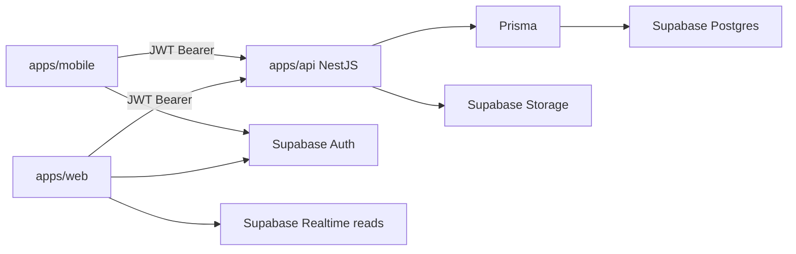
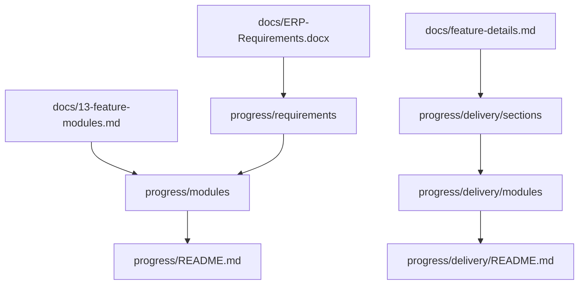

# Engineering Agent Handoff

Agent-oriented guide for building features in this monorepo and tracking progress correctly. Companion to the UI guide: [design-system-handoff.md](./design-system-handoff.md).

**Goal:** implement FE/BE work the same way this codebase does, and update `progress/` after you ship.

---

## 1. Purpose and reading order

1. **This doc** — architecture, stack, naming, patterns, progress tracking
2. **[design-system-handoff.md](./design-system-handoff.md)** — visual UI recipes (tables, charts, tokens)
3. **[demo-seed.md](./demo-seed.md)** — run locally with demo data
4. Deep dives as needed: [02-system-architecture](./02-system-architecture.md), [08-auth-and-rbac](./08-auth-and-rbac.md), [09-api-design](./09-api-design.md), [11-backend-guidelines](./11-backend-guidelines.md), [16-coding-standards](./16-coding-standards.md)

### Docs vs code (known drift)

Prefer the **live repo** over older numbered docs when they conflict:

| Topic | Older docs say | Live repo |
|-------|----------------|-----------|
| Package manager | pnpm | **npm workspaces** (`packageManager: npm@11.4.2`) |
| NestJS version | 11 | **^10.4** |
| UI package | `packages/ui` | **None** — UI in `apps/web/src/components/ui/` |
| Staff routes | role folders under `(dashboard)` | **`(dashboard)/dashboard/*`** |
| Parent/student | role folders | **`(portal)/portal/{parent\|student}/*`** |
| Charts | Recharts + Tremor | **Recharts only** |
| Tables / forms | TanStack Table, react-hook-form | **Native tables**; local form state |
| Schema sync | migrations folder | **`db:push` in practice** (migrate script exists) |

---

## 2. System architecture



### Responsibility split

| Concern | Owner |
|---------|-------|
| Login, JWT, password reset, MFA | Supabase Auth |
| File uploads | Supabase Storage |
| Live read channels (notices, etc.) | Supabase Realtime |
| RLS (defense in depth) | Supabase (`packages/database/supabase/rls.sql`) |
| Business logic, reports, audit, Prisma writes | NestJS API |

### Golden rules

1. **Next.js never writes business data to Postgres.** Mutations go through NestJS (`/api/v1`). Web may use Supabase client for Auth, Storage, and Realtime reads only.
2. **Branch isolation, not multi-tenant SaaS.** Scope by `branchId` — no shared `tenantId` across institutions. One deployment = one institution (white-label clone).
3. **Dynamic config, not code enums.** Academic structures (programs, batches, statuses) live in DB / lookup tables.
4. **No institution names in code.** Branding from `InstitutionSettings` + env.

### Auth → API flow

1. Web/mobile signs in via Supabase → JWT in session
2. `apiClient` sends `Authorization: Bearer <token>`
3. Nest `AuthGuard` verifies JWT, loads app user
4. `BranchGuard` resolves branch scope
5. `PermissionsGuard` checks `@Permissions('resource.action')`

---

## 3. Monorepo layout (actual)

**Tooling:** Turborepo + **npm workspaces** (`apps/*`, `packages/*`). Node `>=20`.

| Path | Package | Role |
|------|---------|------|
| `apps/api` | `@eims/api` | NestJS REST API (port **3001**) |
| `apps/web` | `@eims/web` | Next.js staff dashboard + portals (port **3000**) |
| `apps/mobile` | `@eims/mobile` | Expo parent/student apps |
| `packages/database` | `@eims/database` | Prisma schema, client, seeds |
| `packages/shared` | `@eims/shared` | Zod schemas, permissions, utils |
| `packages/types` | `@eims/types` | Entity + API TypeScript types |
| `packages/config` | `@eims/config` | Shared TSConfig presets |

Also: `docs/`, `docs/templates/`, `progress/`, `scripts/`.

### Dependency rules

- Apps may depend on `@eims/types`, `@eims/shared`, `@eims/database` (API only for database)
- **Forbidden:** `apps/web` → `@eims/database`
- **Forbidden:** circular package deps; `types` must not depend on `shared` in the wrong direction (shared may import types as needed by package design)
- Import aliases: `@eims/*` for packages; `@/` inside web

### Key root scripts

| Script | Action |
|--------|--------|
| `npm run dev` | Turbo: API + web (and other `dev` tasks) |
| `npm run build` / `lint` / `test` | Turbo pipelines |
| `npm run db:generate` | Prisma client |
| `npm run db:push` | Sync schema to DB (common path) |
| `npm run db:migrate` | Prisma migrate dev |
| `npm run db:seed:all` | Institution + auth + demo |
| `npm run db:seed:verify` | Verify demo seed |
| `npm run verify:app` | Readiness script |
| `npm run mobile:parent` / `mobile:student` | Expo with role |

Env templates: `docs/templates/.env.api.example`, `docs/templates/.env.web.example`. Canonical DB env loaded from `apps/api/.env`.

---

## 4. Tech stack

### Backend (`apps/api`)

| Layer | Choice |
|-------|--------|
| Framework | NestJS **10** |
| ORM | Prisma 6 (`@eims/database`) |
| Validation | Zod schemas from `@eims/shared` + `createZodPipe` |
| Auth verify | `@supabase/supabase-js` in API |
| Email | Nodemailer + Handlebars (`src/templates/email/`) |
| Docs | Swagger at `/api/docs` (non-production) |
| API prefix | `/api/v1` |

### Frontend web (`apps/web`)

| Layer | Choice |
|-------|--------|
| Framework | Next.js **15** App Router, React **19** |
| Styling | Tailwind CSS **v4** (tokens in `globals.css`; no `tailwind.config`) |
| UI primitives | shadcn-style: Radix + CVA + `cn()` |
| Icons | lucide-react |
| Server state | TanStack Query |
| Charts | Recharts |
| Toasts | Sonner |
| Auth client | `@supabase/ssr` |

### Mobile (`apps/mobile`)

Expo Router, Supabase, direct API via `apps/mobile/lib/api.ts`. Does **not** currently consume `@eims/shared` / `@eims/types`. Phase 7 delivery scope is largely deferred — see [18-android-apps.md](./18-android-apps.md) and `progress/delivery/`.

### Documented but not installed / not used

Tremor, TanStack Table, react-hook-form, `packages/ui`, next-intl (i18n prepared in docs only).

---

## 5. Naming conventions

Full detail: [05-naming-conventions.md](./05-naming-conventions.md). Cheat sheet:

| Domain | Rule | Example |
|--------|------|---------|
| Folders | kebab-case | `form-builder/` |
| React components | PascalCase file | `StudentProfileCard.tsx` |
| Hooks | `use` prefix | `use-students.ts` |
| NestJS files | kebab-case + suffix | `students.service.ts` |
| Zod schemas | `.schema.ts` | `create-student.schema.ts` |
| Prisma models | PascalCase singular | `Student` |
| Prisma fields | camelCase | `branchId`, `deletedAt` |
| FKs | `{entity}Id` | `studentId` |
| Booleans | `is` / `has` | `isActive` |
| API base | `/api/v1` | Versioned |
| Resources | kebab-case plural | `/fee-types` |
| Query params | camelCase | `?branchId=&page=1` |
| Permissions | dot-separated | `students.read`, `fees.collect` |
| Env vars | SCREAMING_SNAKE; public `NEXT_PUBLIC_`; institution `INSTITUTION_` | |
| Storage paths | `{bucket}/{branchId}/{entityId}/{filename}` | |
| Git branches | kebab-case | `feature/student-admission` |
| Commits | Conventional Commits | `feat(students): add admission form` |

**Do not:** put institution names in identifiers; use Prisma enums for business statuses (use lookup tables); use vague names (`getData`, `temp`).

**Note:** Older naming docs show a `dto/` folder under Nest modules. Live code validates with **Zod from `@eims/shared`** — do not invent local `*.dto.ts` files unless matching an existing pattern.

---

## 6. Backend patterns

**Layout:** `apps/api/src/`

```
common/          # guards, decorators, pipes, filters, email, cache
modules/         # one folder per domain (~33 modules)
prisma/          # PrismaModule + PrismaService
main.ts          # prefix api/v1, CORS, Swagger
app.module.ts    # imports all feature modules
```

### Module shape

```
modules/students/
├── students.module.ts
├── students.controller.ts
├── students.service.ts
└── students.service.spec.ts   # optional
```

Thin controllers, fat services. Register in `app.module.ts`. Import `AuditModule` when mutations need audit logs.

### Guards and decorators (order matters)

```ts
@UseGuards(AuthGuard, BranchGuard, PermissionsGuard)
@Permissions('students.read')
```

- `@CurrentUser()` — authenticated app user
- `@BranchId()` — resolved branch scope (`null` for Super Admin when unscoped)
- `@Permissions('resource.action')` — required permission code(s)

### Validation recipe

```ts
import { createZodPipe } from '../../common/pipes/zod-validation.pipe';
import { createStudentSchema } from '@eims/shared';
import type { CreateStudentInput } from '@eims/shared';

@Post()
@Permissions('students.create')
create(
  @Body(createZodPipe(createStudentSchema)) body: CreateStudentInput,
  @CurrentUser() user: AuthUser,
) {
  return this.studentsService.create(body, user);
}
```

### Service rules

- Filter soft-deleted rows: `deletedAt: null`
- Inject / filter by `branchId` for branch-scoped entities
- Validate cross-entity rules (e.g. batch belongs to branch)
- Map Prisma → response shapes (often `toResponse()`)
- Call audit service on mutations
- Cross-branch resource access → **404**, not 403
- Multi-entity writes → Prisma `$transaction`

### API shapes (summary)

Full spec: [09-api-design.md](./09-api-design.md).

- List: `{ data: [], meta: { total, page, limit, totalPages } }`
- Create: `201` + resource
- Delete: soft delete, `204`
- Errors: `{ statusCode, message, error, details? }`
- List query: `page`, `limit` (max 100), `search`, `sortBy`, `sortOrder`

Dev base: `http://localhost:3001/api/v1`  
Swagger: `http://localhost:3001/api/docs`

### Feature modules (live)

Under `apps/api/src/modules/`: academic, accounting, ai-attendance, ai-insights, analytics, assessments, attendance, audit, auth, biometric, branches, certificates, communications, dashboard, device-tokens, documents, fees, form-fields, front-office, health, hr, learning, library, notices, parents, payments, payroll, reports, settings, students, timetable, transport, users.

---

## 7. Frontend patterns

**Layout:** `apps/web/src/`

```
app/                 # App Router
components/
  ui/                # primitives
  layout/            # shell, sidebar, tables, page header
  features/          # domain panels/dialogs
  dashboard/         # home widgets
  portal/            # parent/student sections
hooks/
lib/                 # api-client, supabase, permissions, query keys
providers/
```

### Route groups (actual)

| Group | URL space | Audience |
|-------|-----------|----------|
| `(auth)` | `/login`, `/forgot-password`, `/accept-invite` | Public |
| `(dashboard)` | `/dashboard/*` | Staff (permission-driven nav) |
| `(portal)` | `/portal/parent/*`, `/portal/student/*` | Parents / students |
| — | `/print/*` | Print layouts |
| — | `/apply` | Public application form |

**Do not** create separate apps per role. One dashboard shell; filter nav with `usePermissions()`. UI hide/show is UX only — **API always enforces** permissions.

### Data fetching

- Client: `apps/web/src/lib/api-client.ts` — attaches Supabase Bearer token, throws `ApiClientError`
- Server: `apps/web/src/lib/server-api.ts`
- Prefer TanStack Query; invalidate after mutations
- Terminology labels from institution settings — never hardcode “Batch” / “Class” if settings override them

### UI

Follow [design-system-handoff.md](./design-system-handoff.md): ContentPanel, data-table styles, midnight-blue page CTAs, Recharts recipes, etc.

---

## 8. Shared packages and data contracts

```
Zod (@eims/shared)  →  used by Nest createZodPipe + FE forms
Types (@eims/types) →  entity + API response types
Prisma schema       →  packages/database/prisma/schema.prisma
Permissions         →  packages/shared/src/constants/permissions.ts
```

### Adding a feature end-to-end

1. **Prisma** — model/fields in `schema.prisma` → `npm run db:push` → `db:generate`
2. **Shared** — Zod schema in `packages/shared` (+ export)
3. **Types** — request/response types in `packages/types` if needed
4. **Permissions** — add codes to `permissions.ts` and seed/role mapping if new
5. **API** — module under `apps/api/src/modules/{feature}/`, register in `app.module.ts`
6. **Web** — page under `app/(dashboard)/dashboard/...` or portal; feature components under `components/features/`
7. **Progress** — update trackers (section 9)
8. **RLS** — if new tables need policies, update `packages/database/supabase/rls.sql`

Seeds: `packages/database/prisma/seed*.ts` and `docs/templates/*.json`. Demo guide: [demo-seed.md](./demo-seed.md).

---

## 9. Progress tracking (required for AI agents)

Manual markdown only — **no automation, no checkboxes**. Status lives in table cells.

Canonical instructions:

- Phase 1–3: [progress/HOW-TO-UPDATE.md](../progress/HOW-TO-UPDATE.md)
- Phase 4–7 delivery: [progress/delivery/HOW-TO-UPDATE.md](../progress/delivery/HOW-TO-UPDATE.md)
- Dashboards: [progress/README.md](../progress/README.md), [progress/delivery/README.md](../progress/delivery/README.md)

### Tracker map



| Scope | Engineering files | Acceptance files | Source doc |
|-------|-------------------|------------------|------------|
| Phase 1–3 (MVP archive) | `progress/modules/*.md` | `progress/requirements/*.md` | ERP-Requirements + 13-feature-modules |
| Phase 4–7 (delivery) | `progress/delivery/modules/*.md` | `progress/delivery/sections/*.md` | feature-details.md |

Do **not** confuse `progress/modules/` with `progress/delivery/modules/`.

### Status vocabulary (exact strings)

| Status | When |
|--------|------|
| `not_started` | No meaningful implementation |
| `partial` | Some layers done |
| `in_progress` | Actively building |
| `done` | Meets scope for that tracker |
| `deferred` | Out of current phase |

### Layer columns

| Column | Means | Values |
|--------|-------|--------|
| DB | Prisma model + schema applied | `done` / `partial` / `—` |
| API | NestJS endpoints | same |
| Web | Next.js UI | same |
| Tests | Unit or e2e | same |

### Definition of done

For **user-facing** features: mark `done` only when **DB + API + Web** are complete. Do **not** mark `done` for schema-only work. Tests optional unless required.

### Update workflow (every ship)

1. Edit the correct **module** file (Phase 1–3 or delivery)
2. Update feature rows (DB / API / Web / Tests + Status)
3. Update **Overall status** at top of module file
4. Update linked **requirements** or **delivery section** acceptance rows
5. Update the matching **README.md** rollup + `"Last updated"`
6. Set **Last updated: YYYY-MM-DD** on every file touched

### Which file to update?

| You changed… | Phase 1–3 | Delivery (4–7) |
|--------------|-----------|----------------|
| NestJS / API | `progress/modules/{module}.md` | `progress/delivery/modules/{module}.md` |
| Next.js UI | same module (Web column) | same |
| Prisma | module (+ maybe `infrastructure.md`) | delivery module |
| Client-visible capability | module + `requirements/{NN}-*.md` | module + `delivery/sections/{NN}-*.md` |
| Phase rollup | `progress/README.md` | `progress/delivery/README.md` |

### Templates

- `progress/_module-template.md`
- `progress/delivery/_module-template.md`

### Do not

- Edit `docs/ERP-Requirements.docx` (signed brief)
- Edit `.cursor/plans/` plan files when updating progress
- Invent new status strings outside the vocabulary above

### Example module header

```markdown
# Module: library

- **Phase:** 5
- **Feature-details:** §8
- **API base:** `/api/v1/library`
- **Overall status:** done
- **Last updated:** 2026-07-18

## Features

| Feature | DB | API | Web | Tests | Status | Notes |
|---------|----|-----|-----|-------|--------|-------|
| Catalog CRUD | done | done | done | — | done | |
```

---

## 10. Agent workflow checklist

1. **Classify the work** — Phase 1–3 archive vs delivery gap; open the right progress module/section.
2. **Design contracts first** — Prisma → Zod (`@eims/shared`) → types → permission codes.
3. **Implement API** — module + guards + Zod pipe + branch scope + soft delete + audit.
4. **Implement Web** — route under `/dashboard` or `/portal`; match [design-system-handoff.md](./design-system-handoff.md).
5. **Wire nav/permissions** — sidebar only if permission exists; never rely on UI alone.
6. **Verify locally** — `npm run dev`, hit Swagger/health, exercise happy path; use [demo-seed.md](./demo-seed.md) if needed.
7. **Update progress** — module + requirements/section + README `Last updated` (section 9).
8. **Stay white-label** — no hardcoded institution names, academic enums, or brand colors except CSS tokens / midnight CTA pattern.

---

## 11. Key file index

| Concern | Path |
|---------|------|
| API entry | `apps/api/src/main.ts` |
| API root module | `apps/api/src/app.module.ts` |
| Guards / decorators | `apps/api/src/common/guards/`, `.../decorators/` |
| Zod pipe | `apps/api/src/common/pipes/zod-validation.pipe.ts` |
| Example controller | `apps/api/src/modules/students/students.controller.ts` |
| Prisma schema | `packages/database/prisma/schema.prisma` |
| RLS | `packages/database/supabase/rls.sql` |
| Permissions | `packages/shared/src/constants/permissions.ts` |
| Shared schemas | `packages/shared/src/schemas/` |
| Types | `packages/types/src/` |
| Web API client | `apps/web/src/lib/api-client.ts` |
| Web middleware | `apps/web/src/middleware.ts` / `lib/supabase/` |
| Dashboard shell | `apps/web/src/components/layout/dashboard-shell.tsx` |
| Design tokens | `apps/web/src/app/globals.css` |
| UI handoff | `docs/design-system-handoff.md` |
| Demo seed | `docs/demo-seed.md` |
| Progress HOW-TO | `progress/HOW-TO-UPDATE.md` |
| Delivery HOW-TO | `progress/delivery/HOW-TO-UPDATE.md` |
| Progress dashboards | `progress/README.md`, `progress/delivery/README.md` |

### Related deep docs

| Doc | Use when |
|-----|----------|
| [02-system-architecture](./02-system-architecture.md) | Request flows, branch isolation detail |
| [03-tech-stack](./03-tech-stack.md) | Rationale (verify against this handoff) |
| [04-monorepo-structure](./04-monorepo-structure.md) | Folder trees (verify against this handoff) |
| [07-database-design](./07-database-design.md) | Entity map |
| [08-auth-and-rbac](./08-auth-and-rbac.md) | Roles, invites, MFA |
| [12-security](./12-security.md) | Security requirements |
| [14-white-label-config](./14-white-label-config.md) | Institution branding |
| [16-coding-standards](./16-coding-standards.md) | Lint, tests, review checklist |
| [17-clone-and-rebrand](./17-clone-and-rebrand.md) | New institution deploy |
