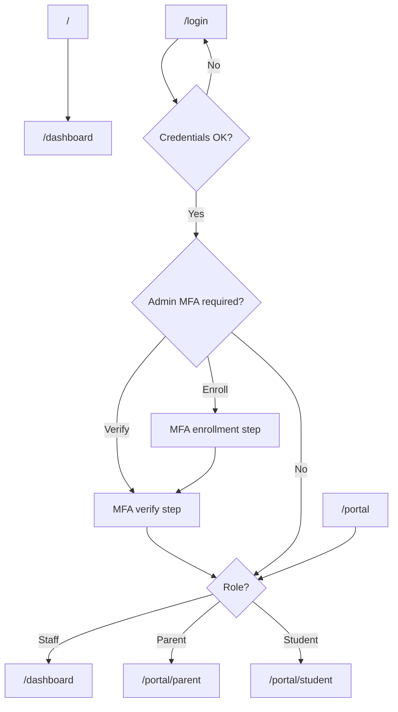

# UI/UX Page Inventory

Designer-facing reference for every screen in the Educational Institution ERP. Use this document to frame Figma artboards, plan navigation flows, and understand feature scope per page.

**Total routes:** 31  
**Shells:** Auth (3), Staff Dashboard (25), Parent/Student Portal (3)  
**Demo logins:** See [demo-seed.md](demo-seed.md) for credentials per role.

---

## Table of contents

1. [How to use this document](#1-how-to-use-this-document)
2. [Design system and shared chrome](#2-design-system-and-shared-chrome)
3. [Navigation and access flows](#3-navigation-and-access-flows)
4. [Role × page matrix](#4-role--page-matrix)
5. [Auth pages](#5-auth-pages)
6. [Staff dashboard pages](#6-staff-dashboard-pages)
7. [Portal pages](#7-portal-pages)
8. [Appendix](#8-appendix)

---

## 1. How to use this document

### Running locally

```bash
npm run db:push
npm run db:seed:all
npm run dev
```

Open **http://localhost:3000** and sign in with a role-specific account from [demo-seed.md](demo-seed.md).

**Password for all demo accounts:** `Nexium@2026!`

| Role | Demo email | Lands on |
|------|------------|----------|
| Super Admin | admin@nexium.edu.pk | `/dashboard` |
| Branch Admin | branchadmin@nexium.edu.pk | `/dashboard` |
| Teacher | ahmed.teacher@nexium.edu.pk | `/dashboard` |
| Accountant | fees@nexium.edu.pk | `/dashboard` |
| Receptionist | reception@nexium.edu.pk | `/dashboard` |
| Parent | rashid.ahmad@nexium.edu.pk | `/portal/parent` |
| Student | ali.khan@nexium.edu.pk | `/portal/student` |

### Per-page template

Each page section includes:

- **URL** — browser path
- **Shell** — Auth, Dashboard, or Portal
- **How to access** — navigation path to reach the page
- **Page title** — visible heading
- **Sections** — ordered UI blocks top to bottom
- **Forms and fields** — inputs, selects, file uploads
- **Buttons and actions** — CTAs and outcomes
- **States** — loading, empty, error, success
- **Links out** — in-page navigation to other routes
- **Permissions** — sidebar visibility and key write permissions

### Figma naming convention

Use: `{Shell} / {Section} / {Page}` — e.g. `Dashboard / Students / Detail`, `Portal / Parent`, `Auth / Login`.

---

## 2. Design system and shared chrome

### Application shells

| Shell | Layout file | Chrome elements |
|-------|-------------|-----------------|
| **Auth** | `apps/web/src/app/(auth)/layout.tsx` | Full-viewport centered card on `bg-muted/40`; institution logo/name; `--institution-primary` accent on icon badge |
| **Dashboard** | `apps/web/src/components/layout/dashboard-shell.tsx` | Fixed left sidebar (nav + profile footer), top header, scrollable main (`p-4 lg:p-6`) |
| **Portal** | `apps/web/src/components/layout/portal-shell.tsx` | Top header (logo, institution name, user name, sign out); mobile bottom tab bar (`md:hidden`) |

### Branding

- Institution name and logo from settings API
- Primary color CSS variable: `--institution-primary`
- Default icon: GraduationCap (Lucide) when no logo
- Browser tab title: institution name (env default: "Educational Institution ERP")

### Shared UI primitives

| Component | Usage |
|-----------|-------|
| `PageHeader` | Page title (h1), muted description, right-aligned action buttons |
| `Card` | All content sections (`CardHeader`, `CardTitle`, `CardContent`) |
| `FilterBar` | Search + filter controls (students, attendance, marks) |
| `PageTabs` | Tabbed views (attendance modes, timetable views, academic tabs) |
| `ListRow` / `ListRowLink` | List items with optional right actions |
| `VirtualList` | Long scrollable lists (attendance, marks entry; max-height 520px) |
| `PaginationBar` | Page navigation (20 items per page) |
| `LinkButton` | Styled navigation buttons in headers |
| Sonner toasts | Success/error feedback (top-right) |
| Skeletons | `PageContentSkeleton`, `ListLoadingSkeleton`, `DashboardPageSkeleton`, `PortalPageSkeleton` |

### Responsive behavior

| Shell | Desktop (`md+`) | Mobile |
|-------|-----------------|--------|
| Dashboard | Persistent sidebar | Hamburger → slide-out sheet (`mobile-nav-sheet.tsx`) |
| Portal | Header only, no bottom nav | Fixed bottom tab bar with safe-area padding |
| Auth | Centered card, max-width `md` | Same, full-width padding |

### Confirmation pattern

Destructive actions use native browser `confirm()` dialogs — no custom modal components.

---

## 3. Navigation and access flows

### Entry flow



### Access guards

| Guard | Location | Behavior |
|-------|----------|----------|
| **Middleware** | `lib/supabase/middleware.ts` | Unauthenticated users → `/login` (except `/`, `/login`, `/forgot-password`, `/accept-invite`) |
| **StaffGuard** | `dashboard-shell.tsx` | Non-staff on `/dashboard/*` → `/portal`; unauthenticated → `/login` |
| **AdminMfaGuard** | `dashboard-shell.tsx` | `super_admin` / `branch_admin` must complete TOTP MFA before dashboard content |
| **Feature flags** | Portal pages | `parentPortal` / `studentPortal` disabled → `/login?error=parent_portal_disabled` or `student_portal_disabled` |
| **Sidebar filter** | `sidebar-nav.tsx` | Nav items hidden when user lacks permission; routes still exist via direct URL |

### Dashboard route tree

```mermaid
flowchart TD
  dash["/dashboard"]
  dash --> profile["/dashboard/profile"]
  dash --> students["/dashboard/students"]
  students --> studentsNew["/dashboard/students/new"]
  students --> studentDetail["/dashboard/students/id"]
  dash --> attendance["/dashboard/attendance"]
  dash --> assessments["/dashboard/assessments"]
  assessments --> marks["/dashboard/assessments/id/marks"]
  dash --> fees["/dashboard/fees"]
  dash --> timetable["/dashboard/timetable"]
  dash --> analytics["/dashboard/analytics"]
  dash --> reports["/dashboard/reports"]
  dash --> documents["/dashboard/documents"]
  dash --> parents["/dashboard/parents"]
  dash --> notices["/dashboard/notices"]
  dash --> academic["/dashboard/academic"]
  dash --> branches["/dashboard/branches"]
  dash --> users["/dashboard/users"]
  dash --> audit["/dashboard/audit"]
  dash --> aiInsights["/dashboard/ai-insights"]
  dash --> aiAttendance["/dashboard/ai-attendance"]
  dash --> communications["/dashboard/communications"]
  dash --> settings["/dashboard/settings"]
  dash --> formFields["/dashboard/form-fields"]
```



### Sidebar navigation (staff dashboard)

| Label | URL | Icon | Permission |
|-------|-----|------|------------|
| Dashboard | `/dashboard` | LayoutDashboard | — |
| Students | `/dashboard/students` | Users | `students.read` |
| Attendance | `/dashboard/attendance` | ClipboardCheck | `attendance.read` |
| Assessments | `/dashboard/assessments` | FileText | `assessments.read` |
| Fees | `/dashboard/fees` | Wallet | `fees.read` |
| Timetable | `/dashboard/timetable` | Calendar | `timetable.read` |
| Analytics | `/dashboard/analytics` | BarChart3 | `analytics.read` |
| Reports | `/dashboard/reports` | FileBarChart | `reports.view` |
| Documents | `/dashboard/documents` | FolderOpen | `documents.read` |
| Parents | `/dashboard/parents` | UserRound | `students.read` |
| Notices | `/dashboard/notices` | Bell | `students.read` |
| Academic | `/dashboard/academic` | BookOpen | `academic.read` |
| Branches | `/dashboard/branches` | Building2 | `branches.read` |
| Users | `/dashboard/users` | UserCog | `users.manage` |
| Audit | `/dashboard/audit` | Shield | `audit.read` |
| AI Insights | `/dashboard/ai-insights` | Sparkles | `ai_insights.read` |
| AI Attendance | `/dashboard/ai-attendance` | ScanLine | `ai_attendance.use` |
| Communications | `/dashboard/communications` | MessageSquare | `communications.send` |
| Settings | `/dashboard/settings` | Settings | `settings.manage` |
| Form fields | `/dashboard/form-fields` | FormInput | `form_fields.manage` |

**Sidebar footer (all staff):** My profile → `/dashboard/profile`; Sign out.

### Portal bottom navigation (mobile)

| Label | URL | Visible when |
|-------|-----|--------------|
| Home | `/portal` | Always |
| Parent | `/portal/parent` | User has `parent` role |
| Student | `/portal/student` | User has `student` role |

---

## 4. Role × page matrix

**Legend:** `Full` = sidebar visible + typical write actions; `View` = sidebar visible, read-focused; `Partial` = sidebar visible, subset of features; `Hidden` = no sidebar (deep-link only); `Portal` = portal-only; `Public` = no auth; `Redirect` = no standalone UI.

| Page URL | Super Admin | Branch Admin | Teacher | Accountant | Receptionist | Parent | Student |
|----------|-------------|--------------|---------|------------|--------------|--------|---------|
| `/` | Redirect | Redirect | Redirect | Redirect | Redirect | Redirect | Redirect |
| `/login` | Public | Public | Public | Public | Public | Public | Public |
| `/forgot-password` | Public | Public | Public | Public | Public | Public | Public |
| `/accept-invite` | Public | Public | Public | Public | Public | Public | Public |
| `/dashboard` | Full | Full | Full | Full | Full | Hidden | Hidden |
| `/dashboard/profile` | Full | Full | Full | Full | Full | Hidden | Hidden |
| `/dashboard/students` | Full | Full | View | View | Partial | Hidden | Hidden |
| `/dashboard/students/new` | Full | Full | Hidden | Hidden | Full | Hidden | Hidden |
| `/dashboard/students/[id]` | Full | Full | View | View | Partial | Hidden | Hidden |
| `/dashboard/attendance` | Full | Full | Full | Hidden | Full | Hidden | Hidden |
| `/dashboard/assessments` | Full | Full | Partial | Hidden | Hidden | Hidden | Hidden |
| `/dashboard/assessments/[id]/marks` | Full | Full | Full | Hidden | Hidden | Hidden | Hidden |
| `/dashboard/fees` | Full | Full | Hidden | Full | Hidden | Hidden | Hidden |
| `/dashboard/timetable` | Full | Full | View | Hidden | Hidden | Hidden | Hidden |
| `/dashboard/analytics` | Full | Full | View | Hidden | Hidden | Hidden | Hidden |
| `/dashboard/reports` | Full | Full | View | View | Hidden | Hidden | Hidden |
| `/dashboard/documents` | Full | Full | View | Hidden | Partial | Hidden | Hidden |
| `/dashboard/parents` | Full | Full | View | View | Partial | Hidden | Hidden |
| `/dashboard/notices` | Full | Full | View | View | Partial | Hidden | Hidden |
| `/dashboard/academic` | Full | Full | Hidden | Hidden | View | Hidden | Hidden |
| `/dashboard/branches` | Full | Partial | Hidden | Hidden | Hidden | Hidden | Hidden |
| `/dashboard/users` | Full | Full | Hidden | Hidden | Hidden | Hidden | Hidden |
| `/dashboard/audit` | Full | Full | Hidden | Hidden | Hidden | Hidden | Hidden |
| `/dashboard/ai-insights` | Full | Full | View | Hidden | Hidden | Hidden | Hidden |
| `/dashboard/ai-attendance` | Full | Full | Full | Hidden | Full | Hidden | Hidden |
| `/dashboard/communications` | Full | Full | Hidden | Full | Hidden | Hidden | Hidden |
| `/dashboard/settings` | Full | Full | Hidden | Hidden | Hidden | Hidden | Hidden |
| `/dashboard/form-fields` | Full | Full | Hidden | Hidden | Hidden | Hidden | Hidden |
| `/portal` | Redirect | Redirect | Redirect | Redirect | Redirect | Redirect | Redirect |
| `/portal/parent` | Hidden | Hidden | Hidden | Hidden | Hidden | Portal | Hidden |
| `/portal/student` | Hidden | Hidden | Hidden | Hidden | Hidden | Hidden | Portal |

**Notes:**
- Branch Admin lacks `branches.manage` — can view/edit branches but not create (API enforced).
- Teacher can enter marks and manage assessment types/series only with `academic.manage` (not granted) — create assessment yes, manage series/types no.
- UI often shows action buttons regardless of write permission; API rejects unauthorized mutations.
- Parent/Student on dashboard routes are redirected to `/portal` by StaffGuard.

---

## 5. Auth pages

### 5.1 Login

| | |
|---|---|
| **URL** | `/login` |
| **Shell** | Auth |
| **How to access** | Direct URL; middleware redirects unauthenticated users here; logged-in users redirected away by role |
| **Source** | `apps/web/src/app/(auth)/login/page.tsx` |

**Page title:** Institution name (dynamic)  
**Subtitle (step-dependent):** "Sign in to your account" / "Set up two-factor authentication" / "Enter your authenticator code"

#### Sections

1. Brand block — circular GraduationCap icon badge (institution primary color)
2. Card with step content (one of three flows below)
3. Footer link — "Forgot password?" (credentials step only)

#### Step A — Credentials (default)

| Field | Type | Required | Placeholder |
|-------|------|----------|-------------|
| Email | email | Yes | `admin@institution.pk` |
| Password | password | Yes | — |

| Button | Outcome |
|--------|---------|
| Sign in | Validates credentials; staff → MFA check or redirect; portal users → redirect |
| Forgot password? | → `/forgot-password` |

#### Step B — MFA enrollment (admin only)

Shown for `super_admin` / `branch_admin` without TOTP (unless `NEXT_PUBLIC_SKIP_ADMIN_MFA=1`).

| Element | Details |
|---------|---------|
| Intro text | Admin accounts must enable two-factor authentication |
| Set up authenticator app | Starts TOTP enrollment |
| QR code | 160×160 image after enrollment start |
| 6-digit code | Verification input |
| Verify & continue | Completes enrollment |

#### Step C — MFA verification

| Field | Type | Required |
|-------|------|----------|
| 6-digit code | text (max 6) | Yes |

| Button | Outcome |
|--------|---------|
| Verify | Validates TOTP → redirect by role |

#### Post-login redirects

| Role | Destination |
|------|-------------|
| Staff | `/dashboard` |
| Parent | `/portal/parent` |
| Student | `/portal/student` |

#### States

| State | UI |
|-------|-----|
| Submitting | Button: "Signing in…" / "Verifying…" / "Starting…"; disabled |
| MFA chunk loading | `PageContentSkeleton` |
| Invalid credentials | Toast: "Invalid email or password" |
| MFA error | Toast: "Invalid verification code", etc. |
| Success | Toast: "Welcome back" → redirect |

#### Links out

- `/forgot-password`
- Role-based redirect (see table above)

---

### 5.2 Forgot Password

| | |
|---|---|
| **URL** | `/forgot-password` |
| **Shell** | Auth |
| **How to access** | Link from login page; direct URL |
| **Source** | `apps/web/src/app/(auth)/forgot-password/page.tsx` |

**Page title:** Institution name  
**Subtitle:** "Reset your password"

#### Sections

1. Brand block (same as login)
2. Form state OR success state
3. "Back to sign in" link

#### Form

| Field | Type | Required | Notes |
|-------|------|----------|-------|
| Email | email | Yes | No visible label (placeholder only) |

| Button | Outcome |
|--------|---------|
| Send reset link | Sends Supabase reset email (redirect target `/login`) |
| Back to sign in | → `/login` |

#### States

| State | UI |
|-------|-----|
| Sending | Button: "Sending…" |
| Success | "If an account exists for {email}, you will receive reset instructions shortly." + toast |
| Error | Toast with Supabase error message |

---

### 5.3 Accept Invite

| | |
|---|---|
| **URL** | `/accept-invite?token={invitation_token}` |
| **Shell** | Auth |
| **How to access** | Invitation link (copied from Users page); direct URL with token param |
| **Source** | `apps/web/src/app/(auth)/accept-invite/page.tsx`, `accept-invite-form.tsx` |

**Page title:** "Join {Institution name}"  
**Subtitle:** "Complete your account setup"

#### Sections

1. Invalid link message (no token)
2. Loading — "Validating invitation…"
3. Error — red error text
4. Invite info panel (read-only, muted background)
5. Registration form

#### Invite info panel

| Field | Value |
|-------|-------|
| Email | From invitation |
| Role | From invitation (read-only) |

#### Registration form

| Field | Type | Required |
|-------|------|----------|
| Full name | text | Yes |
| Password | password | Yes (min 8 chars) |

| Button | Outcome |
|--------|---------|
| Activate account | Creates account → toast → `/login` |

#### States

| State | UI |
|-------|-----|
| Suspense fallback | "Loading…" |
| No token | "Invalid invitation link." |
| Invalid/expired | "This invitation is invalid or has expired." |
| Submitting | Button: "Creating account…" |
| Success | Toast: "Account created! Please sign in." → `/login` |

---

## 6. Staff dashboard pages

### 6.0 Root redirect

| | |
|---|---|
| **URL** | `/` |
| **Shell** | None (immediate redirect) |
| **How to access** | App entry URL |
| **Source** | `apps/web/src/app/page.tsx` |

Redirects to `/dashboard`. No standalone landing page — design note only.

---

### 6.1 Dashboard (overview)

| | |
|---|---|
| **URL** | `/dashboard` |
| **Shell** | Dashboard |
| **How to access** | Sidebar "Dashboard"; post-login redirect for staff; `/` redirect |
| **Source** | `apps/web/src/app/(dashboard)/dashboard/page.tsx` |

**Page title:** "Dashboard"  
**Description:** "Welcome back, {fullName}"

#### Sections

1. **Overview KPI cards** (4-column grid, `md:2` / `lg:4`) — requires `reports.view`
   - Students (total count)
   - Fees collected (amount + pending subtitle)
   - Attendance today (records marked)
   - Parents (count)
2. **Performance (30 days)** — requires `analytics.read`
   - Section heading + "Full analytics" link
   - 3 KPI cards: Avg assessment %, Attendance rate, Assessments held
3. **Recent students** card
   - Up to 5 students (name, clickable rows)
   - "View all" button

#### Actions

| Action | Destination |
|--------|---------------|
| Click student row | `/dashboard/students/{id}` |
| View all | `/dashboard/students` |
| Full analytics | `/dashboard/analytics` |

#### States

| State | UI |
|-------|-----|
| Loading (no user) | `DashboardPageSkeleton` |
| Section loading | Pulsing card skeletons per permission-gated section |
| Empty recent students | Empty list (no message) |
| Missing permission | Section hidden entirely |

---

### 6.2 My Profile

| | |
|---|---|
| **URL** | `/dashboard/profile` |
| **Shell** | Dashboard |
| **How to access** | Sidebar footer "My profile" (not in main nav) |
| **Source** | `apps/web/src/app/(dashboard)/dashboard/profile/page.tsx` |

**Page title:** "My profile"  
**Description:** User email

#### Sections

1. **Account** card — profile edit form
2. **Two-factor authentication** card (`MfaSettings`)
3. **Recent sessions** card — session list with revoke

#### Account form

| Field | Type | Required |
|-------|------|----------|
| Full name | text | No |
| Phone | text | No |

| Button | Outcome |
|--------|---------|
| Save profile | PATCH `/auth/me` |

#### MFA card (three states)

| State | UI |
|-------|-----|
| TOTP enabled | Status text; "Disable MFA" per factor (hidden for admin-locked) |
| Enrolling | QR code, 6-digit input, "Verify & enable" |
| Not enrolled | "Enable authenticator app (TOTP)" |

#### Sessions

| Element | Action |
|---------|--------|
| Session row | Device info + last active |
| Revoke | Ghost button per session |

---

### 6.3 Students (list)

| | |
|---|---|
| **URL** | `/dashboard/students` |
| **Shell** | Dashboard |
| **How to access** | Sidebar "Students" |
| **Permission** | `students.read` |
| **Source** | `apps/web/src/app/(dashboard)/dashboard/students/page.tsx` |

**Page title:** "Students"  
**Description:** "View and manage student records"  
**Header action:** "Admit student" → `/dashboard/students/new`

#### Sections

1. **Filter bar**
2. **All Students ({total})** — paginated list (20/page)

#### Filters

| Control | Type | Behavior |
|---------|------|----------|
| Search by name | text | Enter or "Search" applies, resets page |
| Batch | select | Resets page on change |
| Status | select | Resets page on change |
| Clear filters | button | Shown when any filter active |

#### List row

| Column | Content |
|--------|---------|
| Primary | Full name (link to detail) |
| Secondary | Phone or "—" |
| Right | Batch name or "Unassigned" |

#### Pagination

Previous / Next + "Page X of Y"

#### States

| State | UI |
|-------|-----|
| Loading | `ListLoadingSkeleton` (6 rows) |
| Error | "Failed to load students" (red) |
| Empty | "No students found" |

---

### 6.4 Admit Student (new)

| | |
|---|---|
| **URL** | `/dashboard/students/new` |
| **Shell** | Dashboard |
| **How to access** | Students list → "Admit student" |
| **Permission** | `students.create` (API) |
| **Source** | `apps/web/src/app/(dashboard)/dashboard/students/new/page.tsx` |

**Page title:** "Admit Student"  
**Description:** "Create a new student record"

#### Sections

1. **Student details** card — admission form + dynamic custom fields

#### Form fields

| Field | Type | Required | Notes |
|-------|------|----------|-------|
| Branch | select | Yes* | Only if user has no assigned branch; cascades program/batch |
| Full name | text | Yes | |
| Phone | text | No | Placeholder `03XX-XXXXXXX` |
| Email | email | No | |
| CNIC / B-Form | text | No | |
| Gender | select | No | —, Male, Female, Other |
| Date of birth | date | No | |
| Address | text | No | |
| Program | select | No | Cascades batch |
| Batch | select | No | Filtered by program |
| Photograph | file (`image/*`) | No | Uploaded after create |
| Status | select | Yes | From lookups |
| Custom fields | dynamic | Per config | text, number, date, dropdown, checkbox, file |

| Button | Outcome |
|--------|---------|
| Admit student | POST `/students` → redirect to list |
| Cancel | Browser back |

---

### 6.5 Student Detail

| | |
|---|---|
| **URL** | `/dashboard/students/[id]` |
| **Dynamic segment** | `id` = student UUID |
| **Shell** | Dashboard |
| **How to access** | Students list row; Dashboard recent students |
| **Permission** | `students.read`; mutations per action |
| **Source** | `apps/web/src/app/(dashboard)/dashboard/students/[id]/page.tsx` |

**Page title:** Student full name  
**Description:** `{program} · {batch}`  
**Header action:** "Back to list" → `/dashboard/students`

#### Sections

1. **Profile** — editable fields + photo upload
2. **Enrolled subjects** — checkbox list
3. **Additional information** — read-only custom fields (if any)
4. **Documents ({count})** — upload + list
5. **Attendance history** — date range + records

#### Profile fields

| Field | Type |
|-------|------|
| Photo | file upload (immediate) |
| Full name, Phone, Email, CNIC/B-Form | text |
| Gender | select |
| Date of birth | date |
| Address | text |

| Button | Permission | Outcome |
|--------|------------|---------|
| Save changes | `students.update` | PATCH student |
| Remove student | `students.delete` | DELETE → redirect to list |

#### Enrolled subjects

- Checkbox per subject; "Save subjects" button (`students.update`)

#### Documents

- File input (auto-upload); list with title, category, "Open" button

#### Attendance history

- From/To date inputs (default: last month → today)
- Rows: date | status label

#### States

| State | UI |
|-------|-----|
| Loading | `PageContentSkeleton` |
| Not found | "Student not found" |
| No documents | "No documents uploaded" |
| No attendance | "No records in this range" |

---

### 6.6 Attendance

| | |
|---|---|
| **URL** | `/dashboard/attendance` |
| **Shell** | Dashboard |
| **How to access** | Sidebar "Attendance" |
| **Permission** | `attendance.read`; save requires `attendance.mark` |
| **Source** | `apps/web/src/app/(dashboard)/dashboard/attendance/page.tsx` |

**Page title:** "Attendance"  
**Description:** "Mark daily attendance"

#### Tabs

| Tab | Content |
|-----|---------|
| Students | Batch + date selection, student sheet |
| Teachers | Staff sheet for teachers |
| Staff | Staff sheet for staff |

#### Students tab

**Card: Select batch & date**

| Filter | Type | Default |
|--------|------|---------|
| Date | date | Today |
| Branch | select | Only if no user branch |
| Batch | select | Disabled until branch selected |

**Card: {BatchName} — {date}** (when batch selected)

- Summary: `{marked} marked · {unmarked} unmarked · {total} total`
- Buttons: "Mark all present", "Save attendance"
- Virtual list: student name + status select per row

#### Teachers / Staff tabs

- Date input + "Save" in header
- List: name + status select per member

#### States

| State | UI |
|-------|-----|
| No batch | Filter card only |
| Loading | `ListLoadingSkeleton` |
| Empty batch | "No students in this batch" |
| Save disabled | When no dirty changes (students tab) |

---

### 6.7 Assessments (list)

| | |
|---|---|
| **URL** | `/dashboard/assessments` |
| **Shell** | Dashboard |
| **How to access** | Sidebar "Assessments" |
| **Permission** | `assessments.read`; create `assessments.marks.enter`; series/types `academic.manage` |
| **Source** | `assessments/page.tsx` → `assessments-client.tsx` |

**Page title:** "Assessments"  
**Description:** "Tests, exams, and marks entry"  
**Header actions:** "New assessment" | "Manage series" / "Hide series" | "Manage types" / "Hide types"

#### Sections (toggleable panels)

1. **Assessment series** card
2. **Assessment types** card
3. **Create assessment** card
4. **All assessments ({count})** list

#### Manage series / types

| Create | Name, Code + Add button |
| List row | Name (code), Active/Inactive badge, Edit |
| Inline edit | Name, Code, Active checkbox, Save, Cancel |

#### Create assessment

| Field | Type | Required |
|-------|------|----------|
| Branch | select | If no user branch |
| Name | text | Yes |
| Type | select | Yes |
| Series | select | No |
| Total marks | number | Yes (default 100) |

#### Assessment list row

- Name, subtitle `{type} · {totalMarks} marks`
- Action: "Enter marks" → `/dashboard/assessments/{id}/marks`

---

### 6.8 Enter Marks

| | |
|---|---|
| **URL** | `/dashboard/assessments/[id]/marks` |
| **Dynamic segment** | `id` = assessment UUID |
| **Shell** | Dashboard |
| **How to access** | Assessments list → "Enter marks" on a row |
| **Permission** | `assessments.read`; save `assessments.marks.enter` |
| **Source** | `assessments/[id]/marks/page.tsx` |

**Page title:** "Enter marks"  
**Description:** `{assessment.name} · {totalMarks} total`  
**Header action:** "Back to assessments"

#### Sections

1. **Filter bar** — batch, subject, save button
2. **Students card** — virtual list (when batch + subject selected)

#### Filters

| Control | Type | Notes |
|---------|------|-------|
| Batch | select | Required to load sheet |
| Subject | select | Disabled until batch chosen |
| Save marks | button | Disabled without batch+subject |

#### Per-student row

| Field | Type |
|-------|------|
| Student name | read-only |
| Marks | number (min 0) |
| Remarks | text |

---

### 6.9 Fees

| | |
|---|---|
| **URL** | `/dashboard/fees` |
| **Shell** | Dashboard |
| **How to access** | Sidebar "Fees" |
| **Permission** | `fees.read`; collect `fees.collect` |
| **Source** | `dashboard/fees/page.tsx` |

**Page title:** "Fees"  
**Description:** "Invoices and payment collection"  
**Header action:** "New invoice" / "Cancel" (toggles form)

#### Sections

1. **Create invoice** card (toggle)
2. **Fee defaulters ({total})** card
3. **Invoices ({total})** card — paginated (20/page)

#### Create invoice form

| Field | Type | Required |
|-------|------|----------|
| Student | select | Yes |
| Fee type | select | Yes |
| Amount (PKR) | number | Yes |
| Discount | number | No |
| Late fine | number | No |
| Due date | date | No |

#### Defaulters / invoices list

- Row: student name, due info / fee type + amount, status
- Action: "Record payment" (unpaid only)

#### States

| State | UI |
|-------|-----|
| No defaulters | "No overdue invoices" |
| Loading | `ListLoadingSkeleton` |

---

### 6.10 Timetable

| | |
|---|---|
| **URL** | `/dashboard/timetable` |
| **Shell** | Dashboard |
| **How to access** | Sidebar "Timetable" |
| **Permission** | `timetable.read`; manage `timetable.manage` |
| **Source** | `timetable/page.tsx` → `timetable-client.tsx` |

**Page title:** "Timetable"  
**Description:** "Weekly class schedules"  
**Header action:** "Add slot" / "Cancel" (only if `timetable.manage`)

#### Tabs

| Tab | Filter |
|-----|--------|
| By batch | Select batch |
| By teacher | Select teacher |
| By room | Text input room name |

#### Sections

1. Filter card (per tab)
2. **Schedule conflicts** card (amber border, conditional)
3. **New timetable slot** form (toggle, manage permission)
4. **7 day cards** (Mon–Sun grid)

#### Add slot form

| Field | Type | Default |
|-------|------|---------|
| Batch | select | Required |
| Subject | select | Required |
| Teacher | select | Optional |
| Day | select Mon–Sun | Mon |
| Start time | time | 09:00 |
| End time | time | 10:00 |
| Room | text | Optional |

#### Day card slot block

- `{start}–{end} · {subject}`; subtitle `{batch} · {teacher} · {room}`
- "Remove" button (with `confirm()`, manage permission only)

#### States

| State | UI |
|-------|-----|
| Empty day | "No classes" |
| No conflicts | Conflicts card hidden |

---

### 6.11 Analytics

| | |
|---|---|
| **URL** | `/dashboard/analytics` |
| **Shell** | Dashboard |
| **How to access** | Sidebar "Analytics"; Dashboard "Full analytics" link |
| **Permission** | `analytics.read` |
| **Source** | `dashboard/analytics/page.tsx` |

**Page title:** "Analytics"  
**Description:** "Performance and attendance insights"

#### Sections

1. **KPI row** — 3 stat cards (30-day): Avg assessment %, Attendance rate, Assessments held
2. **Attendance trends** — date-filtered horizontal bar chart
3. **Two-column grid:** Batch performance | Weak subject alerts
4. **Top rankings** — full width

#### Filters and actions

| Section | Controls |
|---------|----------|
| Attendance trends | From date, To date |
| Batch performance | Batch select; **Export CSV** |
| Weak subjects | Threshold number ("Below X %") |
| Top rankings | Assessment select; **Export CSV** |

#### States

| State | UI |
|-------|-----|
| Empty trends | "No attendance data in range" |
| Empty batch | "No assessment data" |
| Empty alerts | "No alerts at this threshold" |
| Empty rankings | "No ranked assessments yet" |

---

### 6.12 Reports

| | |
|---|---|
| **URL** | `/dashboard/reports` |
| **Shell** | Dashboard |
| **How to access** | Sidebar "Reports" |
| **Permission** | `reports.view`; correlation section `analytics.read` |
| **Source** | `reports/page.tsx` → `reports-client.tsx` |

**Page title:** "Reports"  
**Description:** "Institutional reports and exports" (or permission-specific variant)

#### Sections

1. **Overview KPI row** (4 cards) — if `reports.view`
2. **Collection summary** + Export CSV
3. **Fee defaulters** list + Export CSV
4. **Attendance vs performance correlation** — if `analytics.read`

#### Overview KPIs

Students, Parents, Staff users, Attendance today

#### Collection summary

Collected / Pending / Collection rate / Total billed; paid/unpaid counts

#### Correlation section

Batch filter; Pearson stats; student bar chart (top 15); Export CSV

#### States

| State | UI |
|-------|-----|
| No permission | "You do not have permission to view reports." |
| Overview loading | "Loading overview..." |
| Empty defaulters | "No overdue invoices" |
| Empty correlation | "Not enough attendance and assessment data..." |

---

### 6.13 Documents

| | |
|---|---|
| **URL** | `/dashboard/documents` |
| **Shell** | Dashboard |
| **How to access** | Sidebar "Documents" |
| **Permission** | `documents.read`; upload/delete `documents.upload` |
| **Source** | `dashboard/documents/page.tsx` |

**Page title:** "Documents"  
**Description:** "Student files and records"  
**Header action:** "Upload document" / "Cancel" (if `documents.upload`)

#### Sections

1. **Upload panel** (toggle)
2. **All documents** list

#### Upload form

| Field | Type | Required |
|-------|------|----------|
| Student | select | Yes |
| Category | select | Yes |
| Title | text | Yes |
| File | file | Yes |

**Categories:** Admission form, B-Form, CNIC, Fee receipt, Academic record, Other

#### Document list row

Title, student name, category, date; **Open**, **Delete** (delete if upload permission)

#### States

| State | UI |
|-------|-----|
| Empty | "No documents yet" |
| Loading | `ListLoadingSkeleton` |

---

### 6.14 Parents

| | |
|---|---|
| **URL** | `/dashboard/parents` |
| **Shell** | Dashboard |
| **How to access** | Sidebar "Parents" |
| **Permission** | `students.read`; mutations `students.update` |
| **Source** | `dashboard/parents/page.tsx` |

**Page title:** "Parents"  
**Description:** "Guardians linked to students"  
**Header action:** "Add parent" / "Cancel"

#### Sections

1. **New parent / guardian** form (toggle)
2. **All parents** list with inline link-student UI

#### Create form

| Field | Type | Required |
|-------|------|----------|
| Full name | text | Yes |
| Email | email | No |
| Phone | text | No |
| Link to student | select | No |
| Relationship | select | When student selected (Father/Mother/Guardian) |

#### Parent list row

- Name, email · phone
- Linked students with relationship + **Unlink**
- **Link student** toggle → student select + **Link**

---

### 6.15 Notices

| | |
|---|---|
| **URL** | `/dashboard/notices` |
| **Shell** | Dashboard |
| **How to access** | Sidebar "Notices" |
| **Permission** | `students.read`; mutations `students.update` |
| **Source** | `dashboard/notices/page.tsx` |

**Page title:** "Notices"  
**Description:** "Announcements for staff and portals"  
**Header action:** "New notice" / "Cancel"

#### Sections

1. **Branch filter** (multi-branch users without assigned branch)
2. **Create notice** form (toggle)
3. **All notices** list

#### Create form

| Field | Type | Required |
|-------|------|----------|
| Title | text | Yes |
| Body | textarea | Yes |
| Audience | select | Everyone, Parents, Students, Staff, Teachers |

#### Notice list row

Title, body preview (2-line clamp), audience · Published/Draft; **Publish** (drafts), **Delete**

Published notices appear on parent/student portal announcement cards.

---

### 6.16 Academic

| | |
|---|---|
| **URL** | `/dashboard/academic` |
| **Shell** | Dashboard |
| **How to access** | Sidebar "Academic" |
| **Permission** | `academic.read`; mutations `academic.manage` |
| **Source** | `academic/page.tsx` → `academic-client.tsx` |

**Page title:** "Academic"  
**Description:** "Programs, batches, and subjects"

#### Tabs

| Tab | Content |
|-----|---------|
| Programs | Branch filter, add program, list with inline edit |
| Batches | Add batch, list with inline edit |
| Subjects | Add subject, list with inline edit |
| Sessions | Add session, list with inline edit |
| Batch subjects | Batch select + subject checkboxes |

#### Programs tab

- Add: Name*, Code
- Edit inline: Name, Code, Save, Cancel

#### Batches tab

- Add: Program*, Batch name*
- Edit inline: Name, Save, Cancel

#### Subjects tab

- Add: Name*, Code
- Edit inline: Name, Code, Save, Cancel

#### Sessions tab

- Add: Name*, Start date*, End date*
- Edit: Name, dates, Current checkbox

#### Batch subjects tab

- Batch select; subject checkboxes; **Save assignments**

---

### 6.17 Branches

| | |
|---|---|
| **URL** | `/dashboard/branches` |
| **Shell** | Dashboard |
| **How to access** | Sidebar "Branches" |
| **Permission** | `branches.read`; mutations `branches.manage` |
| **Source** | `branches/page.tsx` → `branches-client.tsx` |

**Page title:** "Branches"  
**Description:** "Manage institution branches"  
**Header action:** "Add branch" / "Cancel"

#### Sections

1. **Add branch** form (toggle)
2. **All branches** list

#### Add branch

| Field | Type | Required |
|-------|------|----------|
| Name | text | Yes |
| Code | text | Yes |
| City | text | No |

#### List row

Active/Inactive badge, name, code · city; **Edit**, **Deactivate** (active only)

---

### 6.18 Users

| | |
|---|---|
| **URL** | `/dashboard/users` |
| **Shell** | Dashboard |
| **How to access** | Sidebar "Users" |
| **Permission** | `users.manage` |
| **Source** | `dashboard/users/page.tsx` |

**Page title:** "Users"  
**Description:** "Staff accounts and invitations"  
**Header action:** "Send invitation" / "Cancel"

#### Sections

1. **Send invitation** form (toggle)
2. **Staff** paginated list (20/page)
3. **Pending invitations** list

#### Invite form

| Field | Type | Required |
|-------|------|----------|
| Email | email | Yes |
| Role | select | Yes |

On success: invite link copied to clipboard (`/accept-invite?token=...`) + toast.

#### Staff row

Name, email; roles, branch; **Deactivate** (active users)

#### Invitations row

Email, role, expiry date

---

### 6.19 Audit Logs

| | |
|---|---|
| **URL** | `/dashboard/audit` |
| **Shell** | Dashboard |
| **How to access** | Sidebar "Audit" |
| **Permission** | `audit.read` |
| **Source** | `audit/page.tsx` → `audit-list.tsx` |

**Page title:** "Audit logs"  
**Description:** "System activity trail"

#### Sections

1. **Recent activity** card — paginated log list (20/page, read-only)

#### Log row (monospace)

Action; entity type · entity ID prefix · user name; timestamp

#### Actions

- Paginate only (Previous / Next)

---

### 6.20 AI Insights

| | |
|---|---|
| **URL** | `/dashboard/ai-insights` |
| **Shell** | Dashboard |
| **How to access** | Sidebar "AI Insights" |
| **Permission** | `ai_insights.read` |
| **Source** | `ai-insights/page.tsx` → `ai-insights-client.tsx` |

**Page title:** "AI Insights"  
**Description:** "At-risk detection and performance summaries"

#### Sections (two-column grid)

1. **At-risk students** list
2. **Performance summary** detail panel

#### At-risk row

Student name, reasons, risk level badge (high=red, else amber); **Summary** button

#### Summary panel

Narrative text, overall %, recommendations list (subject: tip)

#### States

| State | UI |
|-------|-----|
| No selection | "Select a student to view AI summary" |
| Empty at-risk | "No at-risk students detected" |

---

### 6.21 AI Attendance

| | |
|---|---|
| **URL** | `/dashboard/ai-attendance` |
| **Shell** | Dashboard |
| **How to access** | Sidebar "AI Attendance" |
| **Permission** | `ai_attendance.use` |
| **Source** | `ai-attendance/page.tsx` → `ai-attendance-client.tsx` |

**Page title:** "AI Attendance"  
**Description:** "Upload a register photo, review suggestions, then confirm — never auto-submitted"

#### 3-step workflow

**Step 1 — Upload register**

| Field | Type | Required |
|-------|------|----------|
| Batch | select | Yes |
| Date | date | No |
| Image | file (`image/*`) | Yes (auto-upload on pick) |

**Step 2 — Analyze & review** (when session active)

- OCR text textarea (optional)
- **Analyze register** button
- Per-student status selects + confidence/source line
- **Confirm attendance** button

**Step 3 — Recent sessions**

- Date · status; **Open** to resume session

---

### 6.22 Communications

| | |
|---|---|
| **URL** | `/dashboard/communications` |
| **Shell** | Dashboard |
| **How to access** | Sidebar "Communications" |
| **Permission** | `communications.send` |
| **Source** | `dashboard/communications/page.tsx` |

**Page title:** "Communications"  
**Description:** "SMS and WhatsApp messaging (Twilio)"

#### Sections (two-column + full width)

1. **Send message**
2. **Bulk actions**
3. **Recent messages** (paginated, 20/page)

#### Send message form

| Field | Type |
|-------|------|
| Channel | SMS / WhatsApp |
| Recipient phone | text (+92...) |
| Message body | textarea |

#### Bulk actions

- **Send fee reminders to defaulters** (uses channel from send form)
- Notice select + **Broadcast notice to parents**

#### Message log row

channel → recipient; status · timestamp

---

### 6.23 Settings

| | |
|---|---|
| **URL** | `/dashboard/settings` |
| **Shell** | Dashboard |
| **How to access** | Sidebar "Settings" |
| **Permission** | `settings.manage` |
| **Source** | `dashboard/settings/page.tsx` |

**Page title:** "Settings"  
**Description:** "Institution profile, terminology, and lookups"  
**Layout:** max-width 2xl centered

#### Sections

1. **Branding**
2. **Terminology**
3. **Feature flags**
4. **Student statuses**
5. Global **Save settings** button

#### Branding card

| Field | Type |
|-------|------|
| Institution name | text |
| Primary color | color (#hex) |
| Phone, Email | text |
| Timezone | text |
| Currency | text (PKR) |
| Logo | file (immediate upload on select) |

#### Terminology card

Batch, Program, Assessment, Session label inputs

#### Feature flags

- Parent portal enabled (checkbox)
- Student portal enabled (checkbox)

#### Student statuses

Existing: code (read-only) + editable label (save on blur); Add: Code, Label

---

### 6.24 Form Fields

| | |
|---|---|
| **URL** | `/dashboard/form-fields` |
| **Shell** | Dashboard |
| **How to access** | Sidebar "Form fields" |
| **Permission** | `form_fields.manage` |
| **Source** | `dashboard/form-fields/page.tsx` |

**Page title:** "Admission form fields"  
**Description:** "Custom fields shown on student admission"  
**Layout:** max-width 3xl centered

#### Sections

1. **Add field** form
2. **Active fields** list

#### Add field form

| Field | Type | Required |
|-------|------|----------|
| Code | text | Yes (auto-normalized) |
| Label | text | Yes |
| Type | select | text, number, date, dropdown, checkbox, file |
| Options | text | Comma-separated (dropdown only) |
| Required | checkbox | No |

#### Active field row

Label, code · type · required · sort order; **Edit**, **Remove**

Custom fields appear on `/dashboard/students/new` under "Additional information".

---

## 7. Portal pages

Portal is **read-only**, **mobile-first**, card-based. No forms, modals, or search on portal content pages.

### 7.1 Portal Index (redirect)

| | |
|---|---|
| **URL** | `/portal` |
| **Shell** | Portal |
| **How to access** | Post-login for portal users; bottom nav "Home" |
| **Source** | `portal/portal/page.tsx` |

**Visible content:** "Redirecting…" (muted text) — transient state only.

**Auto-redirect:**
- Staff → `/dashboard`
- Parent → `/portal/parent`
- Student → `/portal/student`

---

### 7.2 Parent Portal

| | |
|---|---|
| **URL** | `/portal/parent` |
| **Shell** | Portal |
| **How to access** | Post-login redirect; bottom nav "Parent" |
| **Role** | `parent`; feature flag `parentPortal` enabled |
| **Source** | `portal/portal/parent/page.tsx` |

**Page title:** "Parent portal"  
**Subheading:** "Welcome, {parent fullName}"

#### Sections (top to bottom)

1. Page header
2. **Announcements** card (conditional) — notice title + body list
3. **System message** card (conditional) — e.g. unlinked profile
4. **Per-child cards** — one card per linked child

#### Each child card

| Subsection | Content |
|------------|---------|
| Header | Child full name + relationship code |
| AI performance summary | Optional: narrative, overall %, subject recommendations |
| Recent attendance | `{date} — {status}` (last 30 days, max 10) |
| Recent assessments | `{assessment} — {grade} ({percentage}%)` (max 5) |
| Class timetable | `{Day} {start}–{end} · {subject} · {room}` |
| Fees | Outstanding total in header; invoice list (max 5) |

#### States

| State | UI |
|-------|-----|
| Loading | `PortalPageSkeleton` |
| Error | "Unable to load portal." (red) |
| No parent profile | "No parent profile linked to your email. Contact the institution." |
| No children | Welcome header only (no empty message) |
| Section empty | "No records yet", "No timetable published", "No invoices" |
| No announcements | Section hidden |

---

### 7.3 Student Portal

| | |
|---|---|
| **URL** | `/portal/student` |
| **Shell** | Portal |
| **How to access** | Post-login redirect; bottom nav "Student" |
| **Role** | `student`; feature flag `studentPortal` enabled |
| **Source** | `portal/portal/student/page.tsx` |

**Page title:** "Student portal"  
**Subheading:** `{fullName} · {program} · {batch}`

#### Sections

1. Page header
2. **System message** card (unlinked profile)
3. **Announcements** card (conditional)
4. **Data cards** (when profile exists):

| Card | Content |
|------|---------|
| Recent attendance | Date + status (max 10) |
| Assessments | Name, grade, percentage (max 10) |
| Class timetable | Day, time, subject, room |
| Fees · Outstanding {amount} | Invoice list (max 10) |

#### States

| State | UI |
|-------|-----|
| Loading | `PortalPageSkeleton` |
| Error | "Unable to load portal." |
| No student profile | Message card only |
| Section empty | "No records", "No timetable published", "No invoices" |

---

## 8. Appendix

### 8.1 Quick index (all 31 routes)

| # | URL | Page name | Shell | Sidebar / Nav | Permission | Parent route |
|---|-----|-----------|-------|---------------|------------|--------------|
| 1 | `/` | Root redirect | — | — | — | — |
| 2 | `/login` | Login | Auth | — | Public | — |
| 3 | `/forgot-password` | Forgot password | Auth | Login link | Public | — |
| 4 | `/accept-invite` | Accept invite | Auth | Invite link | Public | — |
| 5 | `/dashboard` | Dashboard | Dashboard | Dashboard | — | — |
| 6 | `/dashboard/profile` | My profile | Dashboard | Footer link | — | — |
| 7 | `/dashboard/students` | Students | Dashboard | Students | `students.read` | — |
| 8 | `/dashboard/students/new` | Admit student | Dashboard | Students CTA | `students.create` | `/dashboard/students` |
| 9 | `/dashboard/students/[id]` | Student detail | Dashboard | Student row | `students.read` | `/dashboard/students` |
| 10 | `/dashboard/attendance` | Attendance | Dashboard | Attendance | `attendance.read` | — |
| 11 | `/dashboard/assessments` | Assessments | Dashboard | Assessments | `assessments.read` | — |
| 12 | `/dashboard/assessments/[id]/marks` | Enter marks | Dashboard | Assessment row | `assessments.read` | `/dashboard/assessments` |
| 13 | `/dashboard/fees` | Fees | Dashboard | Fees | `fees.read` | — |
| 14 | `/dashboard/timetable` | Timetable | Dashboard | Timetable | `timetable.read` | — |
| 15 | `/dashboard/analytics` | Analytics | Dashboard | Analytics | `analytics.read` | — |
| 16 | `/dashboard/reports` | Reports | Dashboard | Reports | `reports.view` | — |
| 17 | `/dashboard/documents` | Documents | Dashboard | Documents | `documents.read` | — |
| 18 | `/dashboard/parents` | Parents | Dashboard | Parents | `students.read` | — |
| 19 | `/dashboard/notices` | Notices | Dashboard | Notices | `students.read` | — |
| 20 | `/dashboard/academic` | Academic | Dashboard | Academic | `academic.read` | — |
| 21 | `/dashboard/branches` | Branches | Dashboard | Branches | `branches.read` | — |
| 22 | `/dashboard/users` | Users | Dashboard | Users | `users.manage` | — |
| 23 | `/dashboard/audit` | Audit logs | Dashboard | Audit | `audit.read` | — |
| 24 | `/dashboard/ai-insights` | AI Insights | Dashboard | AI Insights | `ai_insights.read` | — |
| 25 | `/dashboard/ai-attendance` | AI Attendance | Dashboard | AI Attendance | `ai_attendance.use` | — |
| 26 | `/dashboard/communications` | Communications | Dashboard | Communications | `communications.send` | — |
| 27 | `/dashboard/settings` | Settings | Dashboard | Settings | `settings.manage` | — |
| 28 | `/dashboard/form-fields` | Form fields | Dashboard | Form fields | `form_fields.manage` | — |
| 29 | `/portal` | Portal redirect | Portal | Home tab | Auth | — |
| 30 | `/portal/parent` | Parent portal | Portal | Parent tab | `parent` role | — |
| 31 | `/portal/student` | Student portal | Portal | Student tab | `student` role | — |

### 8.2 Cross-page navigation map

| From page | UI element | To page |
|-----------|------------|---------|
| `/` | Auto redirect | `/dashboard` |
| `/login` | Forgot password? | `/forgot-password` |
| `/login` | Post-login (staff) | `/dashboard` |
| `/login` | Post-login (parent) | `/portal/parent` |
| `/login` | Post-login (student) | `/portal/student` |
| `/forgot-password` | Back to sign in | `/login` |
| `/accept-invite` | Success | `/login` |
| `/dashboard` | Recent student row | `/dashboard/students/[id]` |
| `/dashboard` | View all | `/dashboard/students` |
| `/dashboard` | Full analytics | `/dashboard/analytics` |
| Sidebar footer | My profile | `/dashboard/profile` |
| `/dashboard/students` | Admit student | `/dashboard/students/new` |
| `/dashboard/students` | Student name row | `/dashboard/students/[id]` |
| `/dashboard/students/new` | Success | `/dashboard/students` |
| `/dashboard/students/[id]` | Back to list | `/dashboard/students` |
| `/dashboard/students/[id]` | After delete | `/dashboard/students` |
| `/dashboard/assessments` | Enter marks | `/dashboard/assessments/[id]/marks` |
| `/dashboard/assessments/[id]/marks` | Back to assessments | `/dashboard/assessments` |
| `/dashboard/users` | Invite link (clipboard) | `/accept-invite?token=...` |
| `/portal` | Auto redirect | `/portal/parent` or `/portal/student` or `/dashboard` |
| Portal shell | Home tab | `/portal` |
| Portal shell | Parent tab | `/portal/parent` |
| Portal shell | Student tab | `/portal/student` |

### 8.3 Designer backlog (known UX gaps)

These are implementation gaps useful for design improvement proposals:

- Several list pages lack explicit empty states (parents, notices, branches, staff list, audit, communications log, academic lists, form-fields).
- Most pages lack error banners — failures surface only via toasts or silent empty data.
- Analytics and AI Insights have no loading skeletons.
- Mutating actions (create/edit/delete) are often shown without checking manage/update permissions.
- Login does not display `?error=parent_portal_disabled` or `student_portal_disabled` query messages.
- Forgot-password email field has no visible label (placeholder only).
- Portal sign out does not immediately navigate to login.
- Destructive confirmations use native browser dialogs, not designed modals.

---

*Generated from `apps/web/src/app/` route files. For API and permission details, see [08-auth-and-rbac.md](08-auth-and-rbac.md) and [13-feature-modules.md](13-feature-modules.md).*
